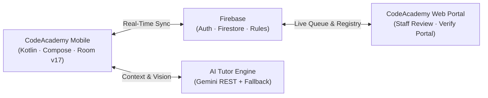

<p align="center">
  
</p>

<p align="center">
  
  
  
  
  
</p>

**CodeAcademy Mobile** is a native Android learning application built with **Kotlin** and **Jetpack Compose** for mastering Front-End Web Development (**HTML5**, **CSS3**, and **JavaScript**) through structured bilingual modules, an integrated mobile Playground IDE, rubric-reviewed capstone projects, and verifiable digital certificates.

Companion web ecosystem (Facilitator & Super Admin Portal + Public Certificate Verification): [**`codeacademy-web`**](https://github.com/ivhan9867/codeacademy-web)

---

## Ecosystem Architecture



---

## Core Capabilities

### Structured Front-End Curriculum
Full offline-first Markdown curriculum available natively in **Indonesian** and **English** (100% content parity across 172 lessons per language):

| Course ID | Track | Modules | Section Quizzes | Final Exam | Final Project |
| :--- | :--- | :---: | :---: | :---: | :---: |
| `fe-web-foundation-00` | Web Foundation: From Zero to First Code | 106 | 5 (110 Qs) | 20 Qs | Portfolio Web Page |
| `fe-css-02` | Modern CSS Layout: Flexbox & Grid | 32 | 3 (40 Qs) | 16 Qs | Responsive Layout System |
| `fe-js-03` | JavaScript Fundamentals | 34 | 3 (40 Qs) | 20 Qs | Interactive DOM App |

Each course also includes a dedicated **Glossary**, **Cheat Sheet**, and rule-based interactive coding missions.

### Mobile Playground IDE
- Two-tier mobile editor with `index.html`, `style.css`, and `script.js` tabs, quick code-symbol bar, and line numbers.
- Live `WebView` sandbox preview and headless JavaScript console.
- Collapsible mission panel that validates student code against lesson rules directly inside the editor.

### Multi-Screen Capstone Submission & Rating Flow
- **3-Step Compose Wizard**: *Brief & Self-Check Rubric* → *Code Editor & File/ZIP Upload* → *Repository Link, Notes & Readiness Check*.
- **Animated Waiting & Live Queue Screen**: Real-time Firestore queue position (`Queue #N of M`) with manual refresh and live code preview.
- **Dedicated Revision & Approval Screens**: Clear facilitator feedback callouts, combined `40% Quiz + 60% Project` final grade breakdown, and one-tap certificate access.
- **Post-Approval Review Rating**: Interactive 1–5 star rating, aspect chips, and optional comment synced to the Staff Portal.

### Cosmic Observatory Digital Certificates
- Animated deep-space & champagne-gold diploma screen with fullscreen landscape preview.
- Native **1920×1200 HD PNG** renderer supporting **Save to Gallery** (`MediaStore`) and **Image Share** (`FileProvider`).
- Unique `CC-yyyyMMxxxx-xxxxxx` credential IDs verifiable publicly via the Web Verification Portal.

### Multimodal AI Tutor, Localization & Community
- **Context-Aware AI Tutor**: Understands the active course, lesson, and Playground draft, with image/screenshot attachment support and resilient fallback handling.
- **4-Language Interface**: Symmetric localization across **Indonesian (`ID`)**, **English (`EN`)**, **Japanese (`JA`)**, and **Chinese (`ZH`)** (`1,326` string keys per locale).
- **Gamification & Social**: XP, levels, daily streaks, daily missions, 1-minute code challenges, leaderboard, per-course discussion forums, and customizable public profiles.

---

## Tech Stack

| Layer | Technologies |
| :--- | :--- |
| Language & Build | Kotlin `2.2.10`, Android Gradle Plugin `9.1.1`, KSP `2.3.6`, Java 11 |
| UI & Navigation | Jetpack Compose (BOM `2024.09.00`), Material 3, Navigation Compose `2.8.9`, Coil `2.7.0` |
| Local Persistence | Room `2.7.0` (schema v17 with full migrations), DataStore Preferences `1.1.7` |
| Cloud & Networking | Firebase BoM `34.17.0` (Auth, Firestore, App Check, Firebase AI), Credential Manager, Retrofit + OkHttp + Moshi |
| Testing | JUnit 4, Robolectric `4.16.1`, Roborazzi `1.59.0`, Coroutines Test |
| SDK Targets | `minSdk 24` · `targetSdk 36` · `compileSdk 36.1` |

---

## Project Structure

```text
.
├── app/src/main/
│   ├── assets/
│   │   ├── catalog/               # Bilingual course catalogs (ID & EN)
│   │   ├── content/               # 172 Markdown lessons (ID)
│   │   └── content_en/            # 172 Markdown lessons (EN)
│   ├── java/com/example/
│   │   ├── ai/                    # Multimodal AI tutor & translation services
│   │   ├── data/                  # Room entities/DAOs, repositories, Firestore sync
│   │   ├── ui/                    # Compose screens, components, themes
│   │   └── util/                  # Localization, unlock rules, HD certificate exporter
│   └── res/                       # 4-language strings.xml & FileProvider paths
├── firestore.rules                # Role-based Firestore security rules
└── public/                        # Companion Web Portal source (published to codeacademy-web)
```

---

## Local Development Setup

### Prerequisites
- **Android Studio** (Meerkat / Narwhal or newer) with **JDK 17+**
- **Android SDK 36**
- Optional: A **Google Gemini API key** and your own **Firebase project** (`google-services.json`) for cloud sync and AI features.

### Quick Start

1. **Clone the repository**
   ```bash
   git clone https://github.com/ivhan9867/PRJ-MobileCodeAcademy.git
   cd PRJ-MobileCodeAcademy
   ```

2. **Configure environment variables**
   Copy `.env.example` to `.env` in the repository root and supply your own key:
   ```dotenv
   GEMINI_API_KEY=your_api_key_here
   ```
   > `.env` is ignored by Git and injected into `BuildConfig` at build time.

3. **Firebase setup (optional for offline mode)**
   Place your project's `google-services.json` inside `app/` and deploy `firestore.rules` via Firebase Console to enable real-time sync, submissions, forums, and certificate verification. Without cloud setup, offline Room storage works out of the box.

4. **Build & run**
   ```bash
   ./gradlew assembleDebug
   ```

---

## Verification & Unit Tests

```bash
# Compile Kotlin sources
./gradlew :app:compileDebugKotlin

# Verify 4-language strings.xml parity and format specifiers
./gradlew testDebugUnitTest --tests "com.example.StringParityAndFormatTest"

# Verify course catalog parser and localization mappings
./gradlew testDebugUnitTest --tests "com.example.CourseCatalogParserTest" --tests "com.example.DataLabelMappingsTest"

# Verify hardcoded string guardrails
./gradlew testDebugUnitTest --tests "com.example.ActiveTreeHardcodedStringCheckTest"
```

---

## Security & Privacy Notes
- Never commit `.env`, `local.properties`, release keystores (`*.jks`), or personal credentials.
- Release signing reads `KEYSTORE_PATH`, `STORE_PASSWORD`, `KEY_PASSWORD`, and `KEY_ALIAS` from environment variables.
- Firestore write access is enforced server-side via role-based rules in `firestore.rules`.
