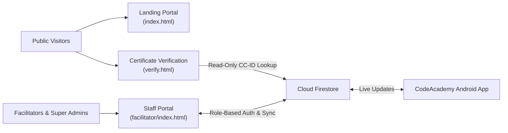

<p align="center">
  
</p>

<p align="center">
  
  
  
  
</p>

**CodeAcademy Web** is the companion web ecosystem for [**CodeAcademy Mobile**](https://github.com/ivhan9867/PRJ-MobileCodeAcademy). Built as a zero-build static web application backed by **Firebase Authentication** and **Cloud Firestore**, it provides real-time capstone grading, forum moderation, push announcements, student review analytics, and public certificate verification.

---

## Portal Architecture



---

## Included Modules

| Portal | Entry Point | Capabilities |
| :--- | :--- | :--- |
| **Landing Page** | `index.html` | Unified entry point to the mobile curriculum overview, staff workspace, verification portal, and documentation. |
| **Staff Portal** | `facilitator/index.html` | Role-gated workspace (**Facilitator** & **Super Admin**) with real-time project grading, live code preview sandbox, rubric score calculator (`40% Quiz + 60% Project`), forum moderation, Android push announcements, student review ratings, certificate registry, team management, and learner analytics. |
| **Verification Portal** | `verify.html` | Public lookup for `CC-yyyyMMxxxx-xxxxxx` credentials directly against Firestore, rendering a matching **Cosmic Observatory Diploma** with **Print / Save PDF** and shareable `?id=` URLs. |
| **User Documentation** | `docs/Manual_Book_CodeAcademy.html` | Printable web user manual documenting student and staff workflows. |

---

## Staff Portal Highlights

- **Pending-First Review Queue**: Defaults to active `Pending Review` submissions with live status counts (`Pending`, `Revision`, `Approved`, `All`) so reviewed items move out of the queue automatically, paired with row-level delete and `Clear Approved` cleanup controls.
- **Interactive Grading Modal**: Split-pane source code viewer, sandboxed HTML/CSS/JS live preview iframe, weighted curriculum rubrics, quick bilingual feedback presets, and automatic certificate issuance upon approval.
- **Student Review Ratings**: Real-time visibility into post-approval student ratings (`★ 1–5`, aspect tags, and comments) in the submissions table, review modal, companion side-rail, and Super Admin satisfaction analytics.
- **100% Bilingual Interface (`EN | ID`)**: Defaults to English (`EN`) with instant live switching to Indonesian (`ID`) across all static views, dynamic tables, dates, and modals (`262` symmetric dictionary keys).

---

## Directory Structure

```text
.
├── index.html                  # Landing page
├── verify.html                 # Public certificate verification page
├── verify.js                   # Firestore credential lookup & diploma renderer
├── firebase-config.js          # Firebase Web SDK configuration
├── assets/
│   ├── web-i18n.js             # Reactive EN / ID localization engine
│   ├── site.css                # Landing & verification diploma stylesheet
│   ├── logo.svg                # Brand mark
│   └── readme-web-hero.svg     # Repository header banner
├── facilitator/
│   ├── index.html              # Facilitator & Super Admin dashboard
│   ├── app.js                  # Real-time Firestore listeners & staff workflows
│   └── style.css               # Dashboard, modal & responsive layout styles
└── docs/
    └── Manual_Book_CodeAcademy.html
```

---

## Running Locally

Serve the directory with any static HTTP server:

```bash
python -m http.server 8080
```

Then open:
- **Landing Page**: `http://localhost:8080/`
- **Staff Portal**: `http://localhost:8080/facilitator/`
- **Certificate Verification**: `http://localhost:8080/verify.html`

> **Firebase Configuration**: Ensure `firebase-config.js` points to your Firebase Web app and that `firestore.rules` from the companion repository is published in Firebase Console. Staff access is authorized via documents in the `facilitators/{email}` Firestore collection with `accessRole` set to `"facilitator"` or `"super_admin"`.

---

## Firestore Collections Shared with Mobile

| Collection | Purpose |
| :--- | :--- |
| `project_submissions` | Student capstone submissions, status transitions, rubric scores, and facilitator feedback |
| `submission_ratings` | Post-approval student review ratings, aspect tags, and comments |
| `certificates` | Publicly verifiable graduation credentials (`CC-...`) |
| `forum_posts` | Course discussion threads, facilitator replies, and verified solutions |
| `announcements` | Staff broadcast announcements delivered to the Android Notifications tab |
| `users` | Learner leaderboard profiles and Super Admin account status controls |
| `facilitators` | Authorized staff directory and role assignments |

---

## Security & Deployment Notes
- Designed for static hosting (GitHub Pages, Firebase Hosting, Netlify, or Vercel) with strict Content Security Policy headers and sandboxed code-preview iframes (`sandbox="allow-scripts"`).
- Never store secret credentials, private keys, or administrative passwords in client-side files; all authorization is enforced through Firebase Authentication and Firestore Security Rules.
