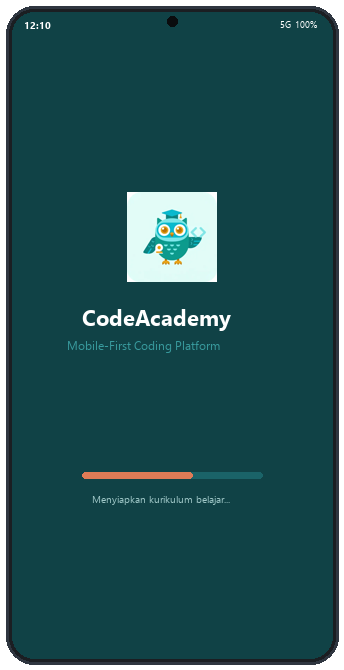
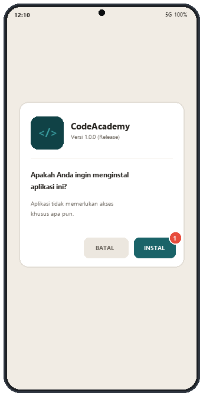
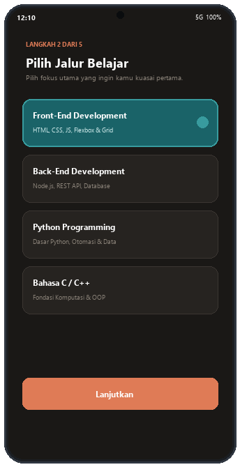
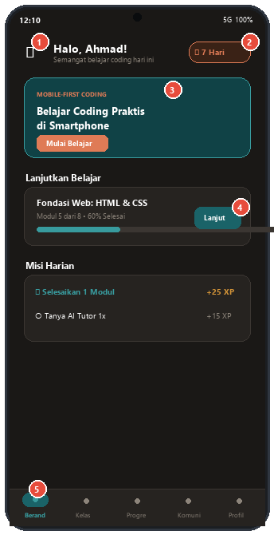
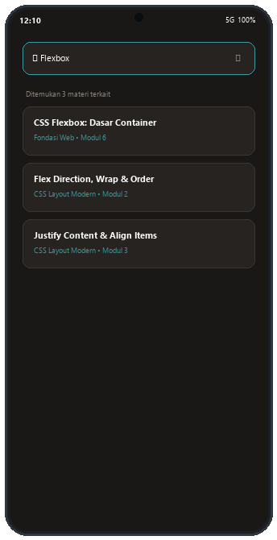
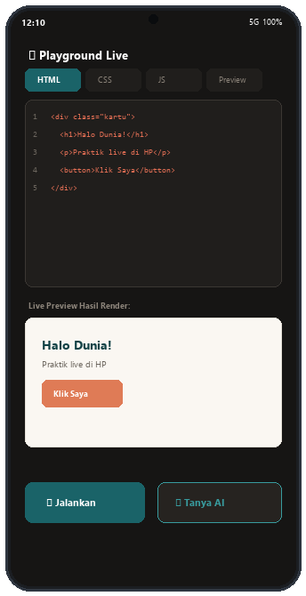
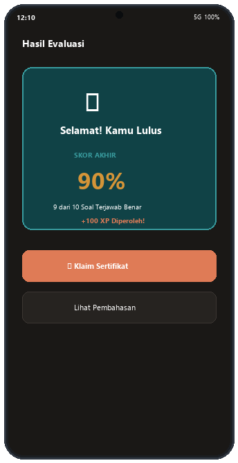
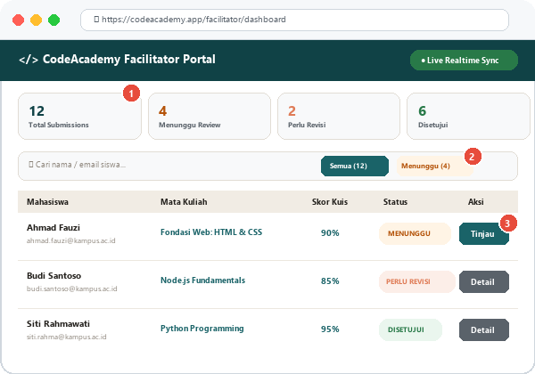

# MANUAL BOOK APLIKASI CODEACADEMY
## Platform Pembelajaran Web Development & Coding Mobile-First (Android & Web Portal)
### Pengembangan Bahan Ajar Edisi I 2026

---

## DAFTAR ISI

- **Halaman Sampul (Cover)** ................................................................................. 1
- **Daftar Isi** ....................................................................................................... 2
- **1. Pengenalan Sistem, Arsitektur & Spesifikasi Platform** .............................. 3
- **2. Unduh & Instalasi Aplikasi Versi Mobile (Android)** ................................ 4
- **3. Pendaftaran Akun, Masuk, Google Linking & Pemulihan Sandi** ............... 5
- **4. Alur Onboarding Siswa Baru (5 Langkah)** ................................................. 6
- **5. Beranda (Home Dashboard), Streak, Misi & Tantangan Kilat** ................. 7
- **6. Menu Samping (Drawer), Pencarian Global & Tersimpan** ......................... 8
- **7. Katalog Kelas, Placement Test & Detail Silabus Kursus** ........................... 9
- **8. Pembelajaran Interaktif (Materi Reader)** ................................................. 10
- **9. Playground Interaktif (Live HTML/CSS/JS Sandbox)** ............................... 11
- **10. Fitur AI Tutor Cerdas (Codi — Google Gemini AI)** ................................ 12
- **11. Sistem Evaluasi, Kuis Bab & Evaluasi Akhir** .......................................... 13
- **12. Pengumpulan Tugas Akhir (Final Project Submission)** ............................. 14
- **13. Forum Diskusi Kelas Real-Time & Targeted Reply** ................................. 15
- **14. Progres Belajar, Papan Peringkat & Sertifikat Digital** ............................. 16
- **15. Profil Pengguna, Peta Aktivitas, Bahasa & Zona Berbahaya** ................. 17
- **16. Halaman Publik Web & Pintu Masuk Portal Staf** ................................... 18
- **17. Portal Web Fasilitator: Proyek, Forum Terverifikasi & Profil** ................. 19
- **18. Panel Super Admin: Tim Fasilitator, Audit Sertifikat & Export CSV** ......... 20
- **19. Portal Verifikasi Sertifikat Publik & Keamanan Firestore** .................... 21

---

## 1. PENGENALAN SISTEM, ARSITEKTUR & SPESIFIKASI PLATFORM

**CodeAcademy** adalah ekosistem pembelajaran pemrograman Web Development *mobile-first* yang menggabungkan **Aplikasi Mobile Android (Offline-First)**, **Backend Cloud Firebase**, dan **Portal Web Multi-Peran** (Halaman Publik, Portal Fasilitator, Panel Super Admin, dan Portal Verifikasi Sertifikat). Sistem ini dirancang agar mahasiswa maupun pembelajar pemula dapat belajar konsep hingga praktik menulis kode HTML, CSS, dan JavaScript langsung dari ponsel, sambil tetap terhubung dengan pendampingan fasilitator secara real-time di layar desktop.

*Gambar 1: Tampilan Layar Pembuka (Splash Screen) Aplikasi CodeAcademy Mobile*

### Spesifikasi Arsitektur & Komponen Sistem:

| Komponen Platform | Teknologi Utama | Fungsi & Tanggung Jawab |
| :--- | :--- | :--- |
| Aplikasi Mobile (Android) | Kotlin, Jetpack Compose Material 3, Room Database, DataStore | Pembelajaran *offline-first*, Playground HTML/CSS/JS, Kuis, Forum, Gamifikasi, AI Tutor Codi |
| Autentikasi & Keamanan | Firebase Authentication (Email, Google Sign-In, Anonymous), `firestore.rules` | Login siswa & staf, penautan akun tamu ke Google (`linkWithCredential`), validasi hak akses per peran |
| Sinkronisasi Cloud | Cloud Firestore (Project `codeacademy-6a361`) | Koleksi `users`, `forum_posts`, `project_submissions`, `certificates`, `announcements`, dan `facilitators` |
| Asisten AI | Firebase AI Logic SDK (Google Gemini AI) | Tutor interaktif sadar konteks modul/kode, pembantu debugging, sapaan ringkas & contoh kode |
| Web Portal Staf & Publik | HTML5, CSS3, Vanilla JS + Firebase Web SDK (`public/`) | Landing page publik, Portal Fasilitator, Panel Super Admin, dan Portal Verifikasi `verify.html` |

### Spesifikasi Kurikulum & Evaluasi Aktual:

| ID Kelas | Judul Kelas | Tingkat | Jumlah Modul | Kuis Bab | Proyek Akhir |
| :--- | :--- | :--- | :---: | :---: | :---: |
| `fe-web-foundation-00` | Fondasi Web: Dari Nol ke Baris Kode Pertama | Orientasi | 106 Modul | 5 Kuis | Ya |
| `fe-css-02` | CSS Layout Modern: Flexbox & Grid | Pemula-Menengah | 24 Modul | 2 Kuis | Ya |
| `fe-js-03` | JavaScript Fundamentals | Pemula | 26 Modul | 2 Kuis | Ya |
| **Total Kurikulum** | **Jalur Spesialisasi Front-End Web Development** | **Berjenjang** | **156 Modul** | **9 Kuis** | **3 Proyek** |

### Matriks Peran Pengguna Ekosistem:
- **Siswa Terdaftar & Tamu (Android):** Membaca 156 modul, menjalankan kode di Playground, bertanya ke AI Tutor Codi, mengikuti kuis, berdiskusi di Forum, mengumpulkan Proyek Akhir, memantau Leaderboard & Sertifikat.
- **Fasilitator (`accessRole: "facilitator"` di Web):** Menilai antrean Proyek Akhir dengan rubrik (40% Kuis + 60% Proyek), menerbitkan sertifikat `CC-...` atau meminta revisi, menjawab & mem-pin *Jawaban Terverifikasi* di Forum, mengirim Pengumuman kelas, dan mengatur Profil Fasilitator.
- **Super Admin (`accessRole: "super_admin"` di Web):** Memiliki seluruh hak akses Fasilitator ditambah manajemen **Tim Fasilitator** (`/facilitators/{email}`), **Sertifikat & Audit**, **Ringkasan Analitik & Direktori Siswa**, serta **Unduh Laporan CSV** nilai dan sertifikat.
- **Publik / Penguji / Rekruter (`verify.html`):** Memeriksa keabsahan ID Kredensial Sertifikat `CC-...` tanpa perlu login.

---

## 2. UNDUH & INSTALASI APLIKASI VERSI MOBILE (ANDROID)

### Spesifikasi Kebutuhan Sistem Minimum:
- **Sistem Operasi:** Android 8.0 (Oreo) atau versi yang lebih baru (API Level 26+).
- **Memori RAM:** Minimal 2 GB (disarankan 4 GB atau lebih agar rendering WebView Live Preview di Playground berjalan mulus).
- **Ruang Penyimpanan Kosong:** Minimal 150 MB untuk aplikasi, Room Database, dan cache materi offline.
- **Koneksi Jaringan:** Materi inti dapat dibaca offline; internet aktif diperlukan untuk AI Tutor Codi, sinkronisasi Google, Forum real-time, Leaderboard, dan pengumpulan Proyek Akhir.
- **Dukungan Bahasa Aplikasi:** Tersedia dalam 4 bahasa antarmuka: **Bahasa Indonesia**, **English**, **日本語 (Jepang)**, dan **中文 (Mandarin)**.

### Langkah-Langkah Pemasangan (Instalasi APK):
1. Unduh berkas installer `CodeAcademy-v1.0-release.apk` dari repositori resmi proyek atau tautan distribusi kelas.
2. Buka folder **Unduhan** (*Downloads*) menggunakan aplikasi **Pengelola Berkas** (*File Manager*) di smartphone Android Anda.
3. Ketuk berkas installer APK CodeAcademy yang telah diunduh.
4. Jika muncul peringatan keamanan sumber tidak dikenal (*Unknown Sources*), pilih **Setelan** lalu aktifkan izin **Izinkan dari sumber ini** (*Allow from this source*).
5. Pada dialog Penginstal Paket Android yang muncul, ketuk tombol **INSTAL** (lihat penunjuk **[1]** pada Gambar 2).
6. Tunggu beberapa detik hingga sistem selesai memverifikasi dan memasang aplikasi.
7. Setelah pemasangan selesai, ketuk tombol **Buka** untuk memulai aplikasi CodeAcademy.

*Gambar 2: Kotak Dialog Penginstal Paket Android*

#### Keterangan Gambar:
- **[1] Tombol Instal:** Ketuk tombol ini untuk mengonfirmasi pemasangan berkas aplikasi CodeAcademy ke perangkat Android Anda.

---

## 3. PENDAFTARAN AKUN, MASUK, GOOGLE LINKING & PEMULIHAN SANDI

Untuk menyinkronkan poin XP, streak harian, riwayat forum, dan sertifikat kelulusan ke Cloud Firestore, pengguna disarankan masuk menggunakan akun terdaftar atau Google Sign-In. Aplikasi juga mendukung **Masuk sebagai Tamu** (autentikasi anonim) yang nantinya dapat ditautkan ke akun Google tanpa kehilangan progres maupun membuat akun ganda di Papan Peringkat.

| Layar Masuk (Login) | Layar Pendaftaran (Register) |
| :---: | :---: |
|  |  |
| *Gambar 3A: Formulir Masuk Akun (Login)* | *Gambar 3B: Formulir Pendaftaran Akun Baru (Register)* |

### Langkah Masuk Akun (Login — Gambar 3A):
1. Buka aplikasi CodeAcademy, lalu masukkan alamat email terdaftar Anda pada kolom **Email** **[1]**.
2. Masukkan kata sandi pada kolom **Kata Sandi** **[1]** (gunakan ikon mata untuk menampilkan/menyembunyikan karakter sandi).
3. Ketuk tombol **Masuk ke Akun** **[3]** untuk masuk ke Beranda aplikasi.
4. **Masuk Instan dengan Google:** Ketuk tombol **Masuk dengan Google** untuk autentikasi satu ketukan via Google Credential Manager. Jika sebelumnya Anda memakai akun Tamu Anonim, sistem otomatis menjalankan penautan akun (*link credential*) agar UID dan poin XP Anda menyatu dan tidak ganda di Leaderboard.
5. **Pemulihan Sandi:** Jika lupa kata sandi akun email, ketuk tautan **Lupa Kata Sandi?** **[2]** untuk mengatur ulang kata sandi.

### Langkah Pendaftaran Akun Baru (Register — Gambar 3B):
1. Pada bagian bawah layar masuk, ketuk tautan **Daftar Sekarang** **[4]** untuk membuka layar pendaftaran (*"Mulai perjalanan codingmu"*).
2. Lengkapi formulir pendaftaran: **Nama Lengkap** (minimal 2 huruf, tidak diawali angka), **Email aktif**, **Kata Sandi** (minimal 6 karakter), dan **Konfirmasi Kata Sandi**.
3. Ketuk tombol **Daftar Akun** untuk membuat akun baru secara lokal & cloud, atau pilih **Daftar dengan Google** untuk registrasi otomatis.

#### Keterangan Gambar 3A:
- **[1] Kolom Input Email & Kata Sandi:** Area pengisian kredensial email dan kata sandi akun pengguna.
- **[2] Tautan Lupa Kata Sandi?:** Membuka alur pemulihan/reset kata sandi pengguna.
- **[3] Tombol Masuk ke Akun:** Memvalidasi kredensial dan membuka dashboard utama.
- **[4] Tautan Daftar Sekarang:** Berpindah dari layar Masuk ke formulir Pendaftaran akun baru (Gambar 3B).

---

## 4. ALUR ONBOARDING SISWA BARU (5 LANGKAH)

Pengguna baru disambut alur **Onboarding Interaktif 5 Langkah** untuk memetakan tujuan belajar dan ritme harian sebelum masuk ke Beranda:

*Gambar 4: Rangkaian 5 Langkah Layar Onboarding Siswa Baru*

### Rincian Tahapan Onboarding:

| Langkah | Nama Tahap | Fungsi & Aksi Pengguna |
| :---: | :--- | :--- |
| **01** | **Welcome Step** | Sambutan bersama maskot **Codi** serta pengenalan metode *microlearning* Web Development 156 modul. |
| **02** | **Code Preview Step** | Simulasi interaktif mengubah elemen kode HTML dan melihat hasil render tampilan secara langsung di layar. |
| **03** | **Community Step** | Pengenalan fitur Forum Diskusi kelas, Papan Peringkat mingguan, serta bimbingan dari Fasilitator. |
| **04** | **Track Selection Step** | Pemilihan jalur kurikulum utama **Front-End Web Development** (HTML5, CSS3, Flexbox/Grid, JavaScript ES6). |
| **05** | **Plan Summary Step** | Penentuan target komitmen belajar harian (10–45 menit/hari), tujuan karier, dan estimasi selesai kelas pertama. |

1. Geser atau ketuk **Lanjut** untuk berpindah antar tahap onboarding, atau ketuk **Lewati** di pojok kanan atas jika ingin langsung menuju ringkasan akhir.
2. Pada tahap 5 (*Atur Ritme Belajarmu*), pilih target waktu harian dan fokus tujuan utama lalu ketuk **Mulai Belajar** untuk membuka Beranda.

---

## 5. BERANDA (HOME DASHBOARD), STREAK, MISI & TANTANGAN KILAT

Beranda merupakan pusat kendali belajar harian yang merangkum status streak, capaian XP, tips harian Codi, kuis kilat 1 menit, misi harian, dan pintasan kelas aktif.

*Gambar 5: Halaman Beranda (Home Dashboard) CodeAcademy*

### Alur & Komponen Utama Beranda:
1. **Header Atas & Badge Streak [1][2]:** Ketuk ikon **Menu Samping (☰)** **[1]** untuk membuka Navigation Drawer, ketuk ikon lonceng untuk membaca **Notifikasi & Pengumuman Fasilitator**, dan pantau **Badge Streak Api** **[2]** yang otomatis menyala ke **1 hari** sejak aktivitas modul atau perolehan XP pertama pada hari tersebut (tersinkronisasi seragam antara Beranda, Progres, dan Profil).
2. **Carousel Atas Seragam (`196 dp`) [3]:** Geser 3 kartu utama dengan tinggi seragam: (a) **Banner Promo Mobile-First Coding** dengan tombol putih kontras tinggi, (b) **Kartu XP Minggu Ini** lengkap dengan animasi *count-up* akurat, level aktif, dan progres target 250 XP tanpa nilai fallback palsu, serta (c) **Kartu Rekomendasi Kelas**.
3. **Strip Streak 7 Hari & Misi Harian:** Menampilkan grid keaktifan 7 hari (dimulai **Senin–Minggu** mengikuti bahasa aplikasi) dan kartu **Misi Harian (+50 XP)**.
4. **Codi Daily Tip & Tantangan Kilat 1 Menit [6]:**
   - **Codi Daily Tip:** Menampilkan tips pemrograman harian (sintaks ber-backtick otomatis dirender *monospace*), lengkap dengan tombol **Tanya AI** dan **Coba Kode**.
   - **Tantangan Kilat 1 Menit (+15 XP):** Soal harian pilihan ganda berlabel badge **A / B / C** dengan *highlight* hijau/merah, ikon status, dan penjelasan inline code saat dijawab. Dilindungi guard 1x per hari (anti *double-tap* & anti-spam) yang tersimpan per tanggal (`yyyy-MM-dd`).
5. **Kartu Lanjutkan Belajar & Jalur Belajar [4][5]:** Menampilkan kelas aktif dan daftar jalur kurikulum (*Front-End Development*) secara ringkas, sementara **Bilah Navigasi Bawah** **[5]** memberi akses satu ketukan ke tab **Beranda**, **Kelas**, **Progres**, **Peringkat**, dan **Profil**.

---

## 6. MENU SAMPING (DRAWER), PENCARIAN GLOBAL & TERSIMPAN

| Menu Navigasi Samping (Drawer) | Pencarian Materi Global (Search) |
| :---: | :---: |
|  |  |
| *Gambar 6A: Laci Navigasi Samping (Drawer)* | *Gambar 6B: Layar Pencarian Materi Global* |

### Langkah Menggunakan Menu Samping & Pencarian:
1. Ketuk ikon **☰** di pojok kiri atas Beranda untuk membuka **Navigation Drawer** (Gambar 6A) yang memuat profil ringkas siswa, level XP, serta fitur-fitur utilitas yang tidak ada di Bottom Navigation: **Cari Materi**, **Modul Tersimpan (Bookmarks)**, **Playground Live**, **AI Tutor Codi**, **Cheat Sheet**, **Sertifikat Saya**, **Pusat Bantuan**, dan **Tentang Aplikasi**.
2. Pilih **Cari Materi** (Gambar 6B) lalu ketik kata kunci teknis (misalnya `"Flexbox"`, `"Semantic"`, atau `"Promise"`) untuk menelusuri seluruh **156 modul** secara instan dan melompat langsung ke modul terkait.
3. Pilih **Modul Tersimpan** untuk membuka daftar materi dan kelas yang telah di-bookmark oleh pengguna.

---

## 7. KATALOG KELAS, PLACEMENT TEST & DETAIL SILABUS KURSUS

| Katalog Kelas (Course Catalog) | Detail Silabus Kelas (Class Detail) |
| :---: | :---: |
|  |  |
| *Gambar 7A: Katalog Kelas & Filter Tonal* | *Gambar 7B: Detail Silabus Kelas & Aksi* |

### Fitur & Cara Menggunakan Menu Kelas:
1. **Tab Filter Progres & Pencarian:** Ketuk tab **Semua**, **Dipelajari**, atau **Selesai**, atau ketik judul/topik pada kotak pencarian ringkas di bagian atas.
2. **Filter Jalur & Tingkat Adaptif Light/Dark:** Saring kelas berdasarkan Jalur dan Tingkat (*Semua*, *Orientasi*, *Pemula*, *Pemula-Menengah*, *Lanjut*) menggunakan chip bergaya **Teal** saat terpilih dan palet tonal kontras tinggi baik pada **Light Mode** maupun **Dark Mode**.
3. **Informasi Lengkap pada Setiap Kartu Kelas:** Setiap kartu menampilkan badge tingkat berwarna konsisten, jumlah modul (`X/Y Modul` atau `Y Modul`), progress bar proporsional, durasi ramah (mis. `9 jam 33 mnt` / `9h 33m`), ikon bookmark (`48 dp`) dengan notifikasi *Toast* `"Disimpan"`, serta tombol aksi **Mulai**, **Lanjutkan**, atau **Ulangi**.
4. **Tes Penempatan (*Placement Test*):** Di bagian Detail Kelas (Gambar 7B), pengguna yang sudah berpengalaman dapat mengikuti *Placement Test* untuk membuka modul lanjutan lebih cepat (*fast-track*) atau langsung membuka daftar bab modul & tautan ke **Forum Diskusi Kelas**.

---

## 8. PEMBELAJARAN INTERAKTIF (MATERI READER)

*Gambar 8: Antarmuka Pembaca Modul Pembelajaran Interaktif*

### Cara Belajar Menggunakan Materi Reader:
1. Buka salah satu modul dari Detail Kelas untuk membaca penjelasan terstruktur, tabel ringkasan, catatan penting (*callout*), dan blok kode berwarna (*syntax highlighting*).
2. Ketuk ikon **Bookmark [2]** di bilah atas untuk menyimpan modul favorit ke daftar *Tersimpan*.
3. Pada setiap blok kode **[3]**, ketuk **Salin Kode** (`48 dp`) untuk menyalin ke clipboard, atau ketuk **Coba di Playground [4]** untuk langsung menjalankan potongan kode tersebut di sandbox eksekusi.
4. Jika ada bagian yang sulit dipahami, ketuk **Tanya AI Tutor [5]** agar konteks modul otomatis dikirim ke AI Tutor Codi.
5. Setelah selesai membaca, ketuk **Tandai Selesai [6]** untuk menyimpan progres ke Room Database, menyalakan streak harian, dan meraih bonus **+20 XP**.

---

## 9. PLAYGROUND INTERAKTIF (LIVE HTML/CSS/JS SANDBOX)

*Gambar 9: Layar Code Playground Multi-Tab dengan Live Preview*

### Alur Penggunaan Live Code Sandbox:
1. Buka **Playground** dari Drawer, kartu Tips Codi, atau tombol **Coba di Playground** di dalam Materi Reader.
2. Pilih tab berkas **`index.html`**, **`style.css`**, atau **`script.js`** untuk menulis atau mengedit kode secara terpisah tanpa *auto-correct* yang mengganggu sintaks. Draf perubahan otomatis tersimpan per kelas di perangkat (*auto-save*).
3. Ketuk tombol **Jalankan / Tab Preview Web** untuk merender tampilan halaman web secara real-time di WebView terisolasi beserta panel **Output Console** (`console.log`) yang dapat dibersihkan.
4. Ketuk **Tanya AI** langsung dari Playground untuk meminta AI Tutor Codi memeriksa kode yang sedang Anda tulis (sistem otomatis mengirim cuplikan kode aktif agar Codi memberi *hint* terarah).

---

## 10. FITUR AI TUTOR CERDAS (CODI — GOOGLE GEMINI AI)

*Gambar 10: Layar Percakapan AI Tutor Codi Berbasis Google Gemini AI*

### Kemampuan & Cara Menggunakan AI Tutor Codi:
1. **Identitas Konsisten & Status Koneksi:** Header menampilkan maskot resmi **Codi** beserta pill status koneksi 1-baris (*Gemini / Offline*) dan konteks kelas/modul aktif.
2. **Respon Cerdas Sesuai Konteks:** Sapaan ringan (seperti *"hai"* atau *"halo"*) dijawab hangat dan singkat dalam 1–2 kalimat tanpa membanjiri layar dengan blok kode panjang, sedangkan pertanyaan teknis dijawab terstruktur dengan contoh kode ringkas dan *hint* pedagogis.
3. **Saran Pertanyaan Cepat (*Prompt Pills*) & Auto-Scroll Keyboard:** Ketuk pill saran di atas kolom ketik untuk langsung bertanya. Saat keyboard terbuka, area chat otomatis menyesuaikan (`imePadding`) dan menggulir ke pesan terbaru.
4. **Hapus Riwayat Aman & Disclaimer:** Ketuk ikon tempat sampah di pojok kanan atas untuk membersihkan chat (dilengkapi **dialog konfirmasi** agar tidak terhapus tidak sengaja). Di bawah kolom input tertera catatan pengingat *"Jawaban AI bisa keliru, periksa kembali"*.

---

## 11. SISTEM EVALUASI, KUIS BAB & EVALUASI AKHIR

| Pengerjaan Kuis (Section Quiz) | Hasil Evaluasi (Result Screen) |
| :---: | :---: |
|  |  |
| *Gambar 11A: Layar Pengerjaan Kuis Berwaktu* | *Gambar 11B: Layar Hasil Evaluasi & Pembahasan* |

### Aturan & Alur Pengerjaan Evaluasi:
1. **Kuis Bab & Evaluasi Akhir:** Setiap kelas dilengkapi kuis per bab (total 9 Kuis Bab) dan 1 Evaluasi Akhir berwaktu sebelum pengumpulan Proyek Akhir.
2. **Ambang Kelulusan (*Passing Grade*):** Siswa dinyatakan **LULUS** jika meraih nilai minimal **70%**. Kelulusan memberikan reward XP dan membuka tahapan kurikulum selanjutnya.
3. **Ulang Kuis & Pembahasan:** Jika nilai belum mencapai 70%, siswa dapat meninjau umpan balik soal lalu menekan tombol **Ulangi Kuis** (*Retake*). Skor kuis akhir otomatis menjadi komponen **40%** dalam perhitungan nilai sertifikat kelulusan.

---

## 12. PENGUMPULAN TUGAS AKHIR (FINAL PROJECT SUBMISSION)

*Gambar 12: Layar Pengumpulan Proyek Akhir (Final Project)*

### Langkah Mengumpulkan Proyek Akhir:
1. Pastikan seluruh modul dan Evaluasi Akhir pada kelas bersangkutan telah selesai dengan skor minimal **70%**.
2. Buka halaman **Proyek Akhir** kelas, baca instruksi studi kasus nyata dan daftar kriteria rubrik penilaian.
3. Lengkapi **URL Repositori / Tautan Proyek**, **Catatan untuk Fasilitator**, serta kode sumber HTML/CSS/JS (dapat diimpor langsung dengan satu ketukan dari **Playground Draft**).
4. Ketuk **Kirim Proyek** untuk mengunggah pengajuan ke koleksi `project_submissions` di Cloud Firestore dengan status awal **`PENDING_REVIEW`**.
5. Pantau hasil review Fasilitator secara real-time di aplikasi:
   - Jika berstatus **`REVISION_REQUESTED`**: baca catatan perbaikan dari Fasilitator, perbaiki kode, lalu kirim ulang (*resubmit*).
   - Jika berstatus **`APPROVED`**: sertifikat digital ber-ID **`CC-...`** otomatis aktif di layar Sertifikat.

---

## 13. FORUM DISKUSI KELAS REAL-TIME & TARGETED REPLY

*Gambar 13: Antarmuka Forum Diskusi Kelas & Thread Komentar*

### Fitur & Alur Diskusi di Aplikasi Android:
1. **Sinkronisasi Dua Arah Real-Time:** Thread dan komentar langsung tersinkronisasi antara aplikasi Android dan **Portal Web Fasilitator** melalui koleksi `forum_posts` Firestore (query langsung tanpa bottleneck composite index dan memastikan autentikasi anonim/Google aktif sebelum memuat).
2. **Filter Diskusi & Badge Fasilitator:** Saring thread menggunakan chip seragam (**Semua**, **Terjawab Fasilitator**, **Milik Saya**, **Populer**). Thread yang telah dibalas staf menampilkan badge **`Dijawab Fasilitator`** serta lencana khusus Fasilitator.
3. **Buka Thread & Balas Spesifik (*Targeted Reply*):**
   - Ketuk pill jumlah balasan untuk memperluas daftar komentar dengan garis vertikal thread penuh dan **Quote Box** kutipan target balasan.
   - Ketuk **Balas** pada topik utama maupun pada komentar tertentu untuk memunculkan banner *"Membalas @Nama"* di atas kolom ketik.
   - Batas penulisan hingga **4000 karakter** dengan validasi server timeout (`10 detik`) dan notifikasi *Toast* apabila jaringan terputus agar indikator kirim tidak berputar tanpa henti.
4. **Error State 3 Varian Jelas:** Jika terjadi gangguan, layar membedakan kondisi **Koneksi Terputus (Offline)**, **Sesi atau Izin Bermasalah (Muat Ulang Sesi)**, dan **Kendala Server (Coba Lagi)** sekaligus menonaktifkan input dengan keterangan yang jelas.

---

## 14. PROGRES BELAJAR, PAPAN PERINGKAT & SERTIFIKAT DIGITAL

*Gambar 14: Papan Peringkat Top 50 & Layar Sertifikat Digital Resmi*

### Rincian Progres, Leaderboard & Sertifikat:
1. **Layar Progres Jujur & Seimbang:** Menampilkan **Level & Sisa XP Menuju Level Berikutnya**, kartu **Streak** dan **Sertifikat** dengan tinggi seimbang, persentase penyelesaian per jalur belajar (minimal **1%** jika minimal 1 modul telah selesai, bukan `0%`), serta rincian per modul.
2. **Papan Peringkat Pelajar (*Leaderboard* Top 50):**
   - Filter periode (**Mingguan**, **Bulanan**, **Sepanjang Waktu**, **Streak 🔥**) dan filter **Jalur** dalam bahasa aktif aplikasi.
   - **Podium Top 3 Simetris:** Jika peserta kurang dari 3, slot kosong tampil sebagai placeholder *"Menunggu"*; badge **`Kamu`** tampil terpisah rapi agar nama tidak terpotong.
   - **Bar Peringkat Pribadi ("Kamu") & Daftar #4+:** Menampilkan peringkat di luar podium serta selisih poin ke peringkat tepat di atas Anda (misal *"Kurang 12 XP lagi ke #2"*).
   - Ketuk baris pengguna lain untuk melihat **Profil Publik** siswa tersebut.
3. **Sertifikat Digital (`CC-...`) & Berbagi Tautan Verifikasi:** Menampilkan nilai akhir gabungan (**40% Kuis + 60% Proyek**), predikat kelulusan, nomor kredensial unik, serta tombol **Bagikan** yang menyertakan URL langsung ke Portal Verifikasi Web (`verify.html?id=CC-...`).

---

## 15. PROFIL PENGGUNA, PETA AKTIVITAS, BAHASA & ZONA BERBAHAYA

*Gambar 15: Layar Profil Pengguna, Peta Aktivitas & Pengaturan*

### Fitur Lengkap Halaman Profil:
1. **Header Profil & Edit Profil Valid:** Menampilkan inisial/nama bersih (otomatis disanitasi tanpa prefiks angka) dan tombol **Edit Profil** dengan validasi nama (minimal 2 huruf, tidak diawali angka) serta **penghitung bio 100 karakter**. Tombol **Simpan** hanya aktif bila input valid dan ada perubahan.
2. **Peta Aktivitas Belajar (*Heatmap* 12 Minggu):** Matriks kontribusi harian ber-outline pada sel kosong, tombol lihat mode 7 hari vs 12 minggu, legenda 2 baris yang bersih (*Kurang → Lebih*), detail harian saat kotak diketuk, serta label *"Hari tersibuk"* yang otomatis tersembunyi hingga minimal ada **3 hari aktif**.
3. **Koleksi Lencana (*Badges*):** Menampilkan lencana terbuka maupun terkunci beserta deskripsi dan status syarat pencapaian.
4. **Preferensi Bahasa, Tema & Notifikasi:** Pilihan **Mode Gelap / Mode Terang**, pengingat belajar (*Notifications*), mengulang Onboarding, dan **4 Bahasa** (*Bahasa Indonesia*, *English*, *日本語*, *中文*) dengan label bersih tanpa duplikasi nama bahasa.
5. **Keluar Akun & Zona Berbahaya (Hapus Akun 2 Langkah):** Menu **Hapus Akun** dipisahkan ke kartu merah **Zona Berbahaya** di bagian paling bawah. Penghapusan akun mewajibkan konfirmasi dua langkah (mengetik kata **`HAPUS`** atau **`DELETE`**) lalu membersihkan data lokal Room, DataStore, serta dokumen `users/{uid}` di Firestore.

---

## 16. HALAMAN PUBLIK WEB & PINTU MASUK PORTAL STAF (`public/index.html`)

Untuk memisahkan fungsi informasi publik dari ruang kerja operasional staf, halaman utama web (`https://ivhan9867.github.io/codeacademy-web/`) berperan sebagai **Portal Publik**:
1. **Ringkasan Platform & Pratinjau Aplikasi:** Memperkenalkan kurikulum mobile-first CodeAcademy serta tautan **Baca Manual Book di Web** dan **Unduh `.docx`**.
2. **Akses Publik Verifikasi Sertifikat:** Tombol langsung ke `verify.html` bagi penguji, dosen, atau rekruter untuk mengecek keaslian sertifikat.
3. **Pintu Masuk Khusus Staf (`Portal Fasilitator & Admin`):** Mengarahkan pengajar dan admin ke halaman autentikasi portal operasional terpisah (`facilitator/index.html`) agar menu staf tidak bercampur dengan beranda publik.

---

## 17. PORTAL WEB FASILITATOR: PROYEK, FORUM TERVERIFIKASI & PROFIL

Portal Staf (`public/facilitator/index.html`) menggunakan layout **Sidebar Workspace** khusus pengajar dengan 3 menu utama untuk peran **Fasilitator (`accessRole: "facilitator"`)**.

*Gambar 16: Dashboard Portal Web Fasilitator CodeAcademy*

### Alur Kerja & Fitur Fasilitator:
1. **Otentikasi & Badge Identitas (`● Live Firebase` vs `● Demo Offline`):**
   - Masuk dengan **Email/Password** atau **Masuk dengan Google** via Firebase Auth; sistem mengecek dokumen `/facilitators/{email}` di Firestore sebelum membuka dashboard.
   - Tersedia pula tombol **Demo Fasilitator** dan **Demo Super Admin** di layar login untuk simulasi offline tanpa menulis ke Firestore.
2. **Modal Profil Fasilitator (Kustomisasi Nama, Peran & Bio):**
   - Klik pill identitas (`👤 Nama · Role`) di pojok kanan atas navbar untuk membuka **Profil Fasilitator**.
   - Perubahan nama, spesialisasi/jabatan, dan bio disimpan ke `localStorage` serta disinkronkan ke `/facilitators/{email}` di Firestore dan otomatis dipakai di Forum, Pengumuman, maupun Sertifikat.
3. **Proyek Akhir (Rubrik 40/60 & Live Preview Aman) [1][2][3]:**
   - Pantau kartu statistik antrean (**Total**, **Menunggu Review**, **Perlu Revisi**, **Disetujui**) **[1]**, saring status/kelas **[2]**, lalu klik **Tinjau** **[3]**.
   - Di Modal Review, telaah kode HTML/CSS/JS peserta sambil menguji hasil tampilannya di tab **Live Preview** bersandbox (`sandbox="allow-scripts"`).
   - Isi checklist rubrik atau skor Proyek (`0–100`); kalkulator otomatis menggabungkan **40% Kuis + 60% Proyek**. Gunakan **Minta Revisi** (disertai tag umpan balik cepat) atau **Setujui & Terbitkan** (otomatis menulis dokumen ke koleksi `certificates`).
4. **Forum Diskusi (Targeted Reply, Pin Terverifikasi & Tandai Membantu):**
   - Filter thread *Semua Kursus* atau *Belum Dijawab Fasilitator*, dan buat topik diskusi baru langsung dari portal web.
   - **Balas Spesifik (*Targeted Reply*):** Klik tombol **Balas** pada komentar mana pun untuk memunculkan banner *"Membalas @Nama"* (dan tombol batal `×`) sehingga balasan tersimpan lengkap dengan `replyToPostId`, `replyToAuthorName`, dan `replyToContentSnippet` yang selaras 100% dengan Android.
   - **Pin Jawaban Terverifikasi (`📌 Pin`):** Menandai jawaban terbaik (`isVerifiedAnswer: true`), otomatis mem-pin jawaban ke urutan teratas balasan dalam thread, dan menyematkan status **`✓ Terjawab`** di header thread.
   - **Tandai Jawaban Membantu (`💡`):** Memberi apresiasi `isHelpful: true` pada kontribusi siswa yang membantu.
5. **Pengumuman Kelas:** Terbitkan pengumuman penting yang langsung dikirim ke koleksi `announcements` untuk tampil di aplikasi Android peserta.

---

## 18. PANEL SUPER ADMIN: TIM FASILITATOR, AUDIT SERTIFIKAT & EXPORT CSV

Akun staf yang memiliki field `accessRole: "super_admin"` pada dokumen Firestore `/facilitators/{email}` otomatis memperoleh lencana **`👑 Super Admin`** di navbar serta akses ke kelompok menu kedua pada **Sidebar Workspace**: **Panel Super Admin** (menu ini disembunyikan dari Fasilitator biasa).

*Gambar 18: Antarmuka Sidebar Workspace & Panel Super Admin CodeAcademy*

### Modul Khusus Super Admin **[1][2][3]**:
1. **Badge Peran & Pemisahan Menu Sidebar [1][2]:** Navbar menandai status **`👑 Super Admin`** **[1]**, sedangkan sidebar kiri menampilkan grup khusus **Panel Super Admin** **[2]** yang terdiri atas 3 sub-panel:
   - **Sertifikat & Audit:** Memantau seluruh sertifikat `CC-...` yang terbit lintas kursus serta mengekspor registri sertifikat.
   - **Tim Fasilitator (`/facilitators/{email}`):** Menambah akun email Google baru sebagai staf, memilih atau mengubah peran (`Fasilitator` vs `Super Admin`), dan mencabut akses akun yang sudah tidak aktif tanpa harus membuka Firebase Console.
   - **Ringkasan & Siswa (`/users`):** Memantau **Rasio Lulus Proyek (%)**, **Topik Forum Terverifikasi**, **Total Sertifikat Terbit**, **Jumlah Siswa Cloud**, dan tabel klasemen siswa aktif (Total XP, Level, Streak).
2. **Unduh Laporan CSV [3]:** Tersedia tombol **Unduh CSV** pada panel **Sertifikat & Audit** maupun **Ringkasan & Siswa** untuk mengekspor rekap sertifikat kelulusan (`codeacademy-sertifikat.csv`) dan laporan nilai proyek akhir (`codeacademy-nilai-proyek.csv`) secara instan di browser.

---

## 19. PORTAL VERIFIKASI SERTIFIKAT PUBLIK & KEAMANAN `firestore.rules`

CodeAcademy menyediakan **Portal Verifikasi Kredensial Publik** di `https://ivhan9867.github.io/codeacademy-web/verify.html` (`public/verify.html`) yang terhubung langsung ke Cloud Firestore (`certificates/{certId}`).

*Gambar 17: Antarmuka Portal Web Verifikasi Sertifikat Digital*

### Cara Validasi & Perlindungan Keamanan Data:
1. **Validasi ID Kredensial (`CC-...`):** Masukkan ID Kredensial sertifikat pada kolom pencarian atau buka langsung tautan bagikan dari aplikasi Android (`verify.html?id=CC-2026110101-A9K3P2`).
2. **Tampilan Hasil Autentik:** Sertifikat valid menampilkan lencana hijau **`✓ KREDENSIAL TERVERIFIKASI`**, nama lengkap lulusan, nama kelas, nilai akhir (**40% Kuis + 60% Proyek**), predikat, tanggal terbit, dan nama fasilitator penilai.
3. **Ringkasan Aturan Keamanan `firestore.rules`:**
   - `/facilitators/{email}`: Hanya **`isSuperAdmin()`** yang dapat membaca seluruh daftar tim, menambah anggota, atau menghapus akses; fasilitator biasa hanya dapat membaca dan memperbarui profil miliknya sendiri tanpa izin mengubah `accessRole`.
   - `/project_submissions/{id}`: Siswa hanya dapat membuat/memperbarui pengajuan miliknya sendiri dengan status `PENDING_REVIEW`; skor & keputusan akhir hanya boleh ditulis oleh `isFacilitator()`.
   - `/forum_posts/{postId}`: Dapat dibaca oleh semua pengguna login (termasuk tamu anonim); siswa tidak dapat memalsukan flag `isMentor`/`authorIsMentor`; fasilitator memiliki hak moderasi, hapus, dan pin jawaban terverifikasi.
   - `/certificates/{certId}`: Terbuka untuk dibaca publik (`verify.html`), namun pencabutan/hapus dibatasi khusus `isFacilitator()` / Admin dan skor valid wajib `70–100`.
   - `/announcements/{id}`: Terbuka dibaca aplikasi siswa, dan hanya boleh dibuat/diubah/dihapus oleh `isFacilitator()`.

---

### Informasi Dokumen:
- **Platform:** CodeAcademy Mobile (Android) & Web Portal (Publik, Fasilitator, Super Admin, Verifikasi)
- **Basis Konten:** Kode Sumber Terkini & Aset Kurikulum (`156 Modul` / `3 Kelas Front-End`)
- **Template Dokumen:** Pengembangan Bahan Ajar Edisi I 2026
- **Tahun Pembuatan:** 2026
