# MANUAL BOOK APLIKASI CODEACADEMY
## Platform Pembelajaran Web Development & Coding Mobile-First (Android & Web Portal)
### Pengembangan Bahan Ajar Edisi I 2026

---

## DAFTAR ISI

- **Halaman Sampul (Cover)** ................................................................................. 1
- **Daftar Isi** ....................................................................................................... 2
- **1. Pengenalan Sistem, Arsitektur & Spesifikasi Platform** .............................. 3
- **2. Use Case Diagram & Matriks Hak Akses Aktor** ........................................ 4
- **3. Flowchart Sistem & Arsitektur Alur Aplikasi Mobile** ............................... 5
- **4. User Flow End-to-End Aplikasi CodeAcademy** .......................................... 6
- **5. Unduh & Instalasi Aplikasi Versi Mobile (Android)** ................................ 7
- **6. Pendaftaran Akun, Masuk, Google Linking & Status Akun** ....................... 8
- **7. Alur Onboarding Siswa Baru (4 Langkah)** ................................................. 9
- **8. Beranda (Home Dashboard), Streak, Misi & Tantangan Kilat** ................. 10
- **9. Menu Samping (Drawer), Pencarian Global & Tersimpan** ......................... 11
- **10. Katalog Kursus, Placement Test & Detail Silabus** ................................... 12
- **11. Pembelajaran Interaktif (Materi Reader)** ................................................. 13
- **12. Playground Interaktif (Web Studio & JS Console)** .................................. 14
- **13. Fitur AI Tutor Cerdas (Codi — Google Gemini AI)** ................................ 15
- **14. Sistem Evaluasi, Kuis Bab & Evaluasi Akhir** .......................................... 16
- **15. Pengumpulan Tugas Akhir (Final Project Submission)** ............................. 17
- **16. Forum Diskusi Real-Time, Targeted Reply & Badge Staf** ........................ 18
- **17. Progres Belajar, Papan Peringkat & Sertifikat Digital** ............................. 19
- **18. Profil Pengguna, Profile Studio, Bahasa & Zona Berbahaya** .................. 20
- **19. Halaman Publik Web & Portal Web Fasilitator** ....................................... 21
- **20. Panel Super Admin: Promosi Tim, Ban Siswa & Export CSV** ................... 22
- **21. Portal Verifikasi Sertifikat Publik & Keamanan Firestore** ...................... 23

---

## 1. PENGENALAN SISTEM, ARSITEKTUR & SPESIFIKASI PLATFORM

**CodeAcademy** adalah ekosistem pembelajaran pemrograman Web Development *mobile-first* yang menggabungkan **Aplikasi Mobile Android (Offline-First)**, **Backend Cloud Firebase**, dan **Portal Web Multi-Peran** (Halaman Publik, Portal Fasilitator, Panel Super Admin, dan Portal Verifikasi Sertifikat). Sistem ini dirancang agar mahasiswa maupun pembelajar pemula dapat belajar konsep hingga praktik menulis kode HTML, CSS, dan JavaScript langsung dari ponsel, sambil tetap terhubung dengan pendampingan fasilitator secara real-time di layar desktop.

*Gambar 1: Tampilan Layar Pembuka (Splash Screen) Aplikasi CodeAcademy Mobile*

### Spesifikasi Arsitektur & Komponen Sistem:

| Komponen Platform | Teknologi Utama | Fungsi & Tanggung Jawab |
| :--- | :--- | :--- |
| Aplikasi Mobile (Android) | Kotlin, Jetpack Compose Material 3, Room Database v16, DataStore | Pembelajaran *offline-first*, Playground (Web Studio & JS Console), Kuis, Forum, Gamifikasi, AI Tutor Codi, 4 Bahasa |
| Autentikasi & Keamanan | Firebase Authentication (Email, Google Sign-In, Anonymous), `firestore.rules` | Login siswa & staf, penautan akun tamu ke Google (`linkWithCredential`), pemantauan status Ban, validasi hak akses |
| Sinkronisasi Cloud | Cloud Firestore (Project `codeacademy-6a361`) | Koleksi `users`, `forum_posts`, `project_submissions`, `certificates`, `announcements`, dan `facilitators` |
| Asisten AI | Direct Gemini REST API + Firebase AI Logic SDK (Google Gemini) | Tutor interaktif sadar konteks modul/kode dalam 4 bahasa (`id`, `en`, `ja`, `zh`) + fallback offline terlokalisasi |
| Web Portal Staf & Publik | HTML5, CSS3, Vanilla JS + Firebase Web SDK (`public/`) | Landing page publik, Portal Fasilitator, Panel Super Admin, dan Portal Verifikasi `verify.html` |

### Spesifikasi Kurikulum & Evaluasi Aktual:

| ID Kursus | Judul Kursus | Tingkat | Jumlah Modul | Kuis Bab | Proyek Akhir |
| :--- | :--- | :--- | :---: | :---: | :---: |
| `fe-web-foundation-00` | Fondasi Web: Dari Nol ke Baris Kode Pertama | Orientasi | 106 Modul | 5 Kuis | Ya |
| `fe-css-02` | CSS Layout Modern: Flexbox & Grid | Pemula-Menengah | 24 Modul | 2 Kuis | Ya |
| `fe-js-03` | JavaScript Fundamentals | Pemula | 26 Modul | 2 Kuis | Ya |
| **Total Kurikulum** | **Jalur Spesialisasi Front-End Web Development** | **Berjenjang** | **156 Modul** | **9 Kuis** | **3 Proyek** |

---

## 2. USE CASE DIAGRAM & MATRIKS HAK AKSES AKTOR

Sebelum masuk ke panduan operasional layar, diagram berikut memetakan interaksi seluruh aktor dalam ekosistem **CodeAcademy** (Aplikasi Mobile Android dan Portal Web):

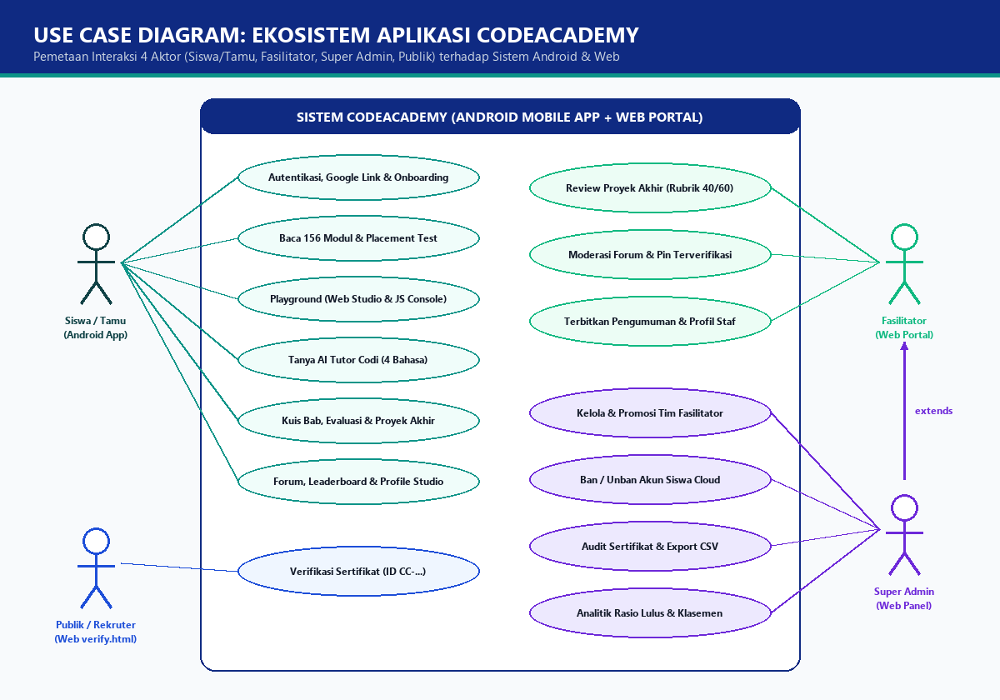
*Gambar 2: Use Case Diagram Ekosistem CodeAcademy (4 Aktor Utama)*

### Matriks Peran & Hak Akses Aktor:

| Aktor | Platform | Hak Akses & Use Case Utama |
| :--- | :---: | :--- |
| **Siswa Terdaftar & Tamu** | Android App | Registrasi/Login/Google Link, Onboarding 4 langkah, membaca 156 modul, Placement Test, Playground (Web Studio & JS Console), AI Tutor Codi, Kuis Bab & Evaluasi Akhir, Pengumpulan Proyek Akhir, Forum Diskusi, Leaderboard, Profile Studio, 4 Bahasa, dan Sertifikat Digital. |
| **Fasilitator** (`accessRole: "facilitator"`) | Web Portal | Login Firebase Auth terverifikasi `/facilitators/{email}`, meninjau antrean Proyek Akhir dengan rubrik (40% Kuis + 60% Proyek), menerbitkan sertifikat `CC-...` atau meminta revisi, menjawab & mem-pin *Jawaban Terverifikasi* di Forum, mengirim Pengumuman kelas, dan mengelola Profil Staf (tersinkron ke `users/{uid}`). |
| **Super Admin** (`accessRole: "super_admin"`) | Web Panel | Mewarisi seluruh hak akses Fasilitator ditambah manajemen **Tim Fasilitator** (tambah staf, promosi `Facilitator → Super Admin` dengan perlindungan sesama Super Admin), **Ban / Unban Akun Siswa**, **Audit & Pencabutan Sertifikat**, **Analitik**, serta **Export CSV**. |
| **Publik / Penguji / Rekruter** | Web (`verify.html`) | Memeriksa keaslian ID Kredensial Sertifikat `CC-...` secara langsung ke Firestore tanpa login, serta membaca/mengunduh Manual Book. |

---

## 3. FLOWCHART SISTEM & ARSITEKTUR ALUR APLIKASI MOBILE

Bagian ini mendokumentasikan alur logika internal aplikasi **CodeAcademy Mobile** secara menyeluruh—mulai dari gerbang masuk (*gatekeeping*), siklus belajar & evaluasi, hingga sinkronisasi data lokal-cloud serta hierarki tampilan profil antar peran.

### 3.1 Flowchart Navigasi & Gatekeeping Aplikasi

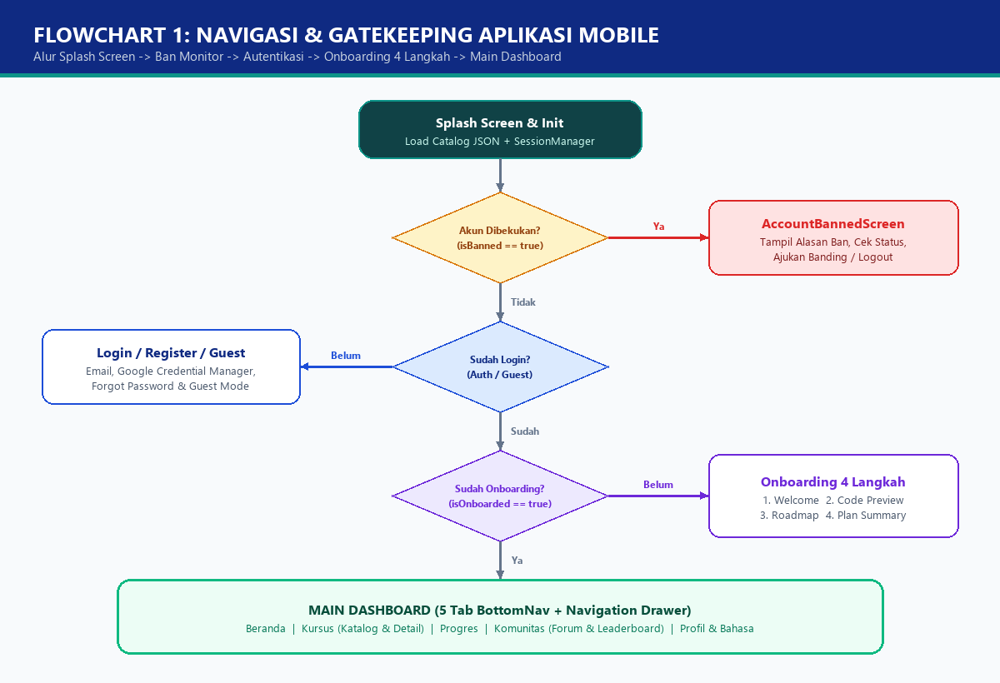
*Gambar 3A: Flowchart Gerbang Masuk, Pemantauan Status Ban, Autentikasi & Onboarding*

1. **Splash Screen & Inisialisasi:** Aplikasi memuat katalog JSON (`front-end.json`) serta membaca preferensi sesi (`SessionManager` DataStore) dan bahasa aktif (`id`, `en`, `ja`, `zh`).
2. **Ban Monitor Guard:** Sistem memeriksa status `isBanned` akun pada Cloud Firestore (`users/{uid}`). Jika akun dibekukan oleh Super Admin, pengguna langsung diarahkan ke **`AccountBannedScreen`** (menampilkan alasan pembekuan, tombol periksa status ulang, ajukan banding via email, dan keluar akun).
3. **Auth & Onboarding Gate:** Jika belum masuk, pengguna diarahkan ke **`LoginScreen`** / **`RegisterScreen`** / **Masuk Tamu**. Pengguna baru yang belum menyelesaikan pengenalan (`isOnboarded == false`) melewati **Onboarding 4 Langkah** sebelum masuk ke **Main Dashboard** (5 Tab BottomNav + Navigation Drawer).

### 3.2 Flowchart Siklus Belajar, Kuis & Penerbitan Sertifikat

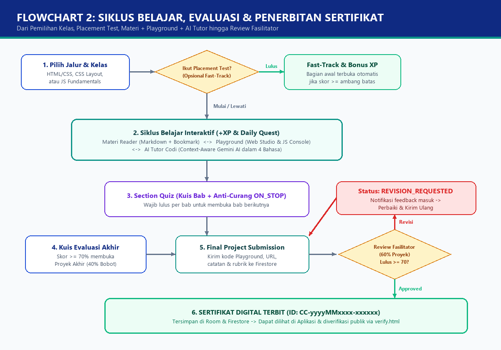
*Gambar 3B: Flowchart Siklus Pembelajaran, Placement Test, Kuis Bab & Penilaian Tugas Akhir*

1. **Fast-Track Placement Test (Opsional):** Di halaman **Detail Kursus**, siswa dapat mengikuti Tes Penempatan untuk membuka bagian materi dasar secara instan sekaligus memperoleh bonus XP.
2. **Siklus Belajar Interaktif:** Siswa membaca 156 modul Markdown di **Materi Reader**, mempraktikkan kode di **Playground** (**Web Studio** & **JS Console**), dan berdiskusi dengan **AI Tutor Codi** (Google Gemini AI dalam 4 bahasa).
3. **Evaluasi Bertingkat:** Setiap bab diakhiri **Section Quiz** (dilengkapi deteksi fokus `ON_STOP`), dilanjutkan **Kuis Evaluasi Akhir** (syarat lulus ≥ 70%) untuk membuka **Final Project Submission**.
4. **Penilaian & Sertifikasi:** Proyek dinilai oleh Fasilitator di Portal Web menggunakan bobot **40% Kuis + 60% Proyek**. Jika status `REVISION_REQUESTED`, siswa menerima notifikasi terlokalisasi untuk memperbaiki dan mengirim ulang; jika `APPROVED` (≥ 70), sertifikat digital **`CC-...`** diterbitkan ke Room & Firestore.

### 3.3 Flowchart Data Offline-First, Isolasi Akun & Hierarki Profil

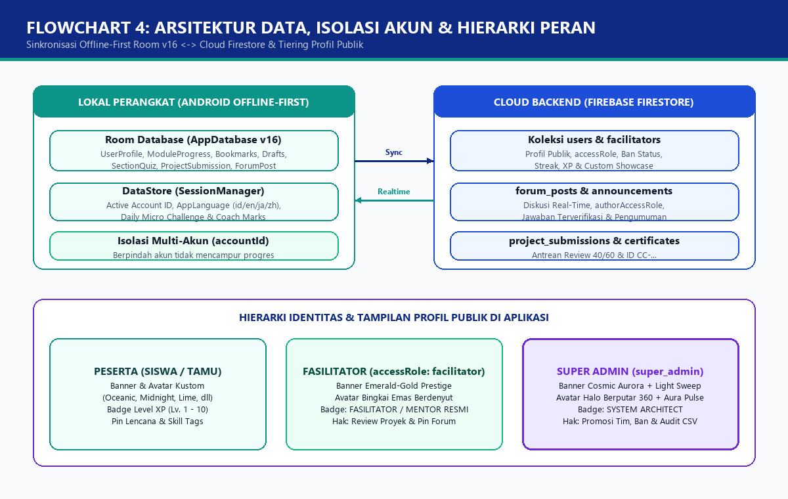
*Gambar 3C: Flowchart Sinkronisasi Room v16 ↔ Cloud Firestore & Tiering Identitas Profil Publik*

- **Isolasi Multi-Akun (`accountId`):** Seluruh progres modul, bookmark, draf Playground, dan riwayat kuis di **Room Database (`AppDatabase v16`)** diisolasi per `accountId` sehingga pergantian akun tidak pernah mencampur data belajar.
- **Hierarki Identitas Profil Publik (`UserPublicProfileDialog` & Forum):**
  - **Peserta (Siswa/Tamu):** Menampilkan banner & avatar kustom pilihan pengguna (*Profile Studio*), level XP (Lv. 1–10), pin lencana, dan *skill tags*.
  - **Fasilitator (`accessRole: "facilitator"`):** Menampilkan tema **Emerald-Gold Prestige**, bingkai avatar berdenyut lembut, lencana **`MENTOR RESMI`**, dan badge **`FASILITATOR`** di Forum.
  - **Super Admin (`accessRole: "super_admin"`):** Menampilkan animasi *looping* bertingkat—banner **Cosmic Aurora** dengan *diagonal holographic light sweep*, avatar dengan **rotating sweep halo ring 360°** dan **pulsing cosmic aura**, lencana **`SYSTEM ARCHITECT`**, serta badge **`SUPER ADMIN`** berkilau di Forum.

---

## 4. USER FLOW END-TO-END APLIKASI CODEACADEMY

Diagram berikut merangkum perjalanan pengalaman pengguna (*User Flow*) dari pertama kali membuka aplikasi hingga meraih sertifikat digital terverifikasi:

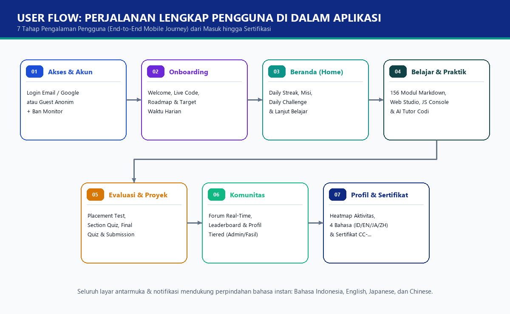
*Gambar 4: Peta User Flow End-to-End Aplikasi CodeAcademy Mobile (7 Tahap Utama)*

### Rincian Matriks User Flow per Layar Aplikasi:

| Tahap | Layar / Fitur | Aksi Pengguna | Respons Sistem & Output |
| :---: | :--- | :--- | :--- |
| **1** | **Splash & Auth** (`Login`, `Register`, `ForgotPassword`, `AccountBanned`) | Masuk via Email, Google Credential Manager, atau Tamu | Validasi sesi, *link credential* jika Tamu → Google, cek status Ban Firestore |
| **2** | **Onboarding** (`Welcome`, `CodePreview`, `Roadmap`, `PlanSummary`) | Coba preset live HTML/CSS & pilih target menit harian | Simpan preferensi belajar ke Room & DataStore (`isOnboarded = true`) |
| **3** | **Beranda & Navigasi** (`Home`, `Drawer`, `Search`, `Bookmarks`, `Notifications`) | Cek streak, misi harian, tantangan kode kilat, atau cari modul | Tambah XP harian, buka modul tersimpan, tampilkan notifikasi sesuai bahasa aktif |
| **4** | **Belajar & Praktik** (`CourseCatalog`, `ClassDetail`, `Materi`, `Playground`, `AiTutor`) | Baca modul Markdown, jalankan HTML/CSS/JS di Web Studio / JS Console, tanya Codi | Auto-save draf kode, eksekusi sandbox terisolasi, hint kontekstual dari Gemini AI |
| **5** | **Evaluasi & Proyek** (`PlacementTest`, `SectionQuiz`, `HasilEvaluasi`, `FinalProject`) | Kerjakan kuis bab/akhir & kirim kode + rubrik Proyek Akhir | Hitung skor, buka kunci bab/proyek, kirim antrean review ke Cloud Firestore |
| **6** | **Komunitas & Sosial** (`Community`, `CourseForum`, `UserPublicProfileDialog`) | Buat topik/balasan forum, lihat Leaderboard & klik profil pengguna | Sinkron real-time Firestore, tampilkan profil unik Peserta / Fasilitator / Super Admin |
| **7** | **Progres, Profil & Sertifikat** (`Progress`, `Profile`, `CertificateList`, `Certificate`) | Kustomisasi Profile Studio, ubah bahasa (ID/EN/JA/ZH), & bagikan sertifikat `CC-...` | Update konfigurasi bahasa instan, tampilkan sertifikat & tautan `verify.html` |

---

## 5. UNDUH & INSTALASI APLIKASI VERSI MOBILE (ANDROID)

### Spesifikasi Kebutuhan Sistem Minimum:
- **Sistem Operasi:** Android 7.0 (Nougat) atau versi yang lebih baru (`minSdk = 24`, `targetSdk = 36`).
- **Memori RAM:** Minimal 2 GB (disarankan 4 GB atau lebih agar rendering WebView Live Preview di Playground berjalan mulus).
- **Ruang Penyimpanan Kosong:** Minimal 150 MB untuk aplikasi, Room Database, dan cache materi offline.
- **Koneksi Jaringan:** Materi inti dapat dibaca offline; internet aktif diperlukan untuk AI Tutor Codi, sinkronisasi Google, Forum real-time, Leaderboard, dan pengumpulan Proyek Akhir.
- **Dukungan Bahasa Aplikasi:** Seluruh antarmuka UI, notifikasi, dan AI Tutor tersedia dalam 4 bahasa: **Bahasa Indonesia**, **English**, **日本語 (Jepang)**, dan **中文 (Mandarin)**.

### Langkah-Langkah Pemasangan (Instalasi APK):
1. Unduh berkas installer `CodeAcademy-v1.0-release.apk` (atau `app-debug.apk` untuk pengujian) dari repositori resmi proyek.
2. Buka folder **Unduhan** (*Downloads*) menggunakan **Pengelola Berkas** (*File Manager*) di smartphone Android Anda.
3. Ketuk berkas installer APK CodeAcademy yang telah diunduh.
4. Jika muncul peringatan keamanan sumber tidak dikenal (*Unknown Sources*), pilih **Setelan** lalu aktifkan izin **Izinkan dari sumber ini** (*Allow from this source*).
5. Pada dialog Penginstal Paket Android yang muncul, ketuk tombol **INSTAL** (lihat penunjuk **[1]** pada Gambar 5).
6. Tunggu beberapa detik hingga sistem selesai memverifikasi dan memasang aplikasi, lalu ketuk **Buka**.

*Gambar 5: Kotak Dialog Penginstal Paket Android*

#### Keterangan Gambar:
- **[1] Tombol Instal:** Ketuk tombol ini untuk mengonfirmasi pemasangan berkas aplikasi CodeAcademy ke perangkat Android Anda.

---

## 6. PENDAFTARAN AKUN, MASUK, GOOGLE LINKING & STATUS AKUN

Untuk menyinkronkan poin XP, streak harian, riwayat forum, dan sertifikat kelulusan ke Cloud Firestore, pengguna disarankan masuk menggunakan akun terdaftar atau Google Sign-In. Aplikasi juga mendukung **Masuk sebagai Tamu** (autentikasi anonim) yang nantinya dapat ditautkan ke akun Google tanpa kehilangan progres maupun membuat akun ganda di Papan Peringkat.

| Layar Masuk (Login) | Layar Pendaftaran (Register) |
| :---: | :---: |
|  |  |
| *Gambar 6A: Formulir Masuk Akun (Login)* | *Gambar 6B: Formulir Pendaftaran Akun Baru (Register)* |

### Langkah Masuk Akun (Login — Gambar 6A):
1. Buka aplikasi CodeAcademy, lalu masukkan alamat email terdaftar Anda pada kolom **Email** **[1]** dan kata sandi pada kolom **Kata Sandi** **[1]** (gunakan ikon mata untuk menampilkan/menyembunyikan sandi).
2. Ketuk tombol **Masuk ke Akun** **[3]** untuk masuk ke Beranda aplikasi.
3. **Masuk Instan dengan Google:** Ketuk tombol **Masuk dengan Google** untuk autentikasi satu ketukan via Google Credential Manager. Jika sebelumnya Anda memakai akun Tamu Anonim, sistem otomatis menjalankan penautan akun (*link credential*) agar UID dan poin XP menyatu.
4. **Pemulihan Sandi:** Jika lupa kata sandi akun email, ketuk tautan **Lupa Kata Sandi?** **[2]** untuk mengatur ulang kata sandi.
5. **Status Pembekuan Akun (`AccountBannedScreen`):** Jika akun melanggar aturan dan dibekukan oleh Super Admin, sistem menampilkan layar pembekuan lengkap dengan alasan, tanggal pembekuan, tombol **Periksa Status Ulang**, **Ajukan Banding via Email**, dan **Keluar & Ganti Akun**.

### Langkah Pendaftaran Akun Baru (Register — Gambar 6B):
1. Pada bagian bawah layar masuk, ketuk tautan **Daftar Sekarang** **[4]** untuk membuka layar pendaftaran.
2. Lengkapi formulir pendaftaran: **Nama Lengkap** (minimal 2 huruf, tidak diawali angka), **Email aktif**, **Kata Sandi** (minimal 6 karakter), dan **Konfirmasi Kata Sandi**, lalu ketuk **Daftar Akun** atau **Daftar dengan Google**.

---

## 7. ALUR ONBOARDING SISWA BARU (4 LANGKAH)

Pengguna baru disambut alur **Onboarding Interaktif 4 Langkah** untuk mengenal ekosistem belajar, mencoba perubahan kode secara langsung, dan menentukan ritme belajar harian sebelum masuk ke Beranda:

*Gambar 7: Rangkaian Layar Onboarding Siswa Baru*

### Rincian 4 Tahapan Onboarding:

| Langkah | Nama Tahap | Fungsi & Aksi Pengguna |
| :---: | :--- | :--- |
| **01** | **Welcome Step** | Sambutan bersama maskot **Codi** serta pengenalan 3 pilar utama: 156 modul terstruktur, Playground & AI Tutor terintegrasi, serta penilaian Fasilitator & sertifikat online. |
| **02** | **Code Preview Step** | Simulasi interaktif mengubah preset HTML & CSS (*Judul Utama*, *Tema Teal*, *Tambah Tombol*) dan melihat **Pratinjau Live** terbarui seketika. |
| **03** | **Roadmap Step** | Peta perjalanan kurikulum berjenjang dari Tahap 01 (Fondasi Web) → Tahap 02 (CSS Layout) → Tahap 03 (JS Fundamentals) → Tahap 04 (Proyek Akhir & Sertifikat). |
| **04** | **Plan Summary Step** | Penentuan target komitmen belajar harian (10–45 menit/hari: *Santai*, *Ideal*, *Serius*, *Intensif*), pilihan tujuan utama, dan estimasi hari selesai kursus pertama. |

1. Ketuk **Lanjut** untuk berpindah antar tahap onboarding, atau ketuk **Lewati** di pojok kanan atas jika ingin langsung menuju ringkasan akhir.
2. Pada tahap 4 (*Atur Ritme Belajarmu*), pilih target waktu harian dan fokus tujuan utama lalu ketuk **Mulai Belajar** untuk membuka Beranda.

---

## 8. BERANDA (HOME DASHBOARD), STREAK, MISI & TANTANGAN KILAT

Beranda merupakan pusat kendali belajar harian yang merangkum status streak, capaian XP, tips harian Codi, kuis kilat 1 menit, misi harian, dan pintasan kursus aktif.

*Gambar 8: Halaman Beranda (Home Dashboard) CodeAcademy*

### Alur & Komponen Utama Beranda:
1. **Header Atas & Badge Streak [1][2]:** Ketuk ikon **Menu Samping (☰)** **[1]** untuk membuka Navigation Drawer, ketuk ikon lonceng untuk membaca **Notifikasi & Pengumuman Fasilitator** (terlokalisasi sesuai bahasa aktif), dan pantau **Badge Streak Api** **[2]** yang otomatis menyala sejak aktivitas belajar pertama pada hari tersebut.
2. **Carousel Atas Seragam (`196 dp`) [3]:** Geser 3 kartu utama: (a) **Banner Promo Mobile-First Coding**, (b) **Kartu XP Minggu Ini** lengkap dengan animasi *count-up*, level aktif, dan target 250 XP, serta (c) **Kartu Rekomendasi Kursus**.
3. **Strip Streak 7 Hari & Misi Harian:** Menampilkan grid keaktifan 7 hari (**Senin–Minggu**) dan kartu **Misi Harian (+50 XP)**.
4. **Codi Daily Tip & Tantangan Kilat 1 Menit [6]:**
   - **Codi Daily Tip:** Tips pemrograman harian lengkap dengan tombol **Tanya AI** dan **Coba Kode**.
   - **Tantangan Kilat 1 Menit (+15 XP):** Soal harian pilihan ganda berlabel badge **A / B / C** dengan penjelasan pembahasan dan proteksi 1x per hari (`yyyy-MM-dd`).
5. **Kartu Lanjutkan Belajar & Jalur Belajar [4][5]:** Menampilkan kursus aktif dan jalur kurikulum, sementara **Bilah Navigasi Bawah** **[5]** memberi akses satu ketukan ke tab **Beranda**, **Kursus**, **Progres**, **Komunitas**, dan **Profil**.

---

## 9. MENU SAMPING (DRAWER), PENCARIAN GLOBAL & TERSIMPAN

| Menu Navigasi Samping (Drawer) | Pencarian Materi Global (Search) |
| :---: | :---: |
| 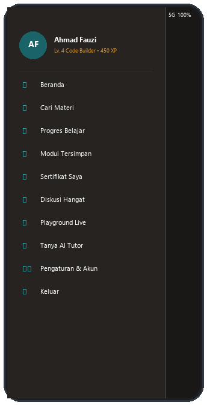 |  |
| *Gambar 9A: Laci Navigasi Samping (Drawer)* | *Gambar 9B: Layar Pencarian Materi Global* |

### Langkah Menggunakan Menu Samping & Pencarian:
1. Ketuk ikon **☰** di pojok kiri atas Beranda untuk membuka **Navigation Drawer** (Gambar 9A) yang memuat profil ringkas siswa, level XP, serta pintasan utilitas: **Cari Materi**, **Modul Tersimpan (Bookmarks)**, **Playground Live**, **AI Tutor Codi**, **Cheat Sheet**, **Sertifikat Saya**, dan **Pusat Bantuan**.
2. Pilih **Cari Materi** (Gambar 9B) lalu ketik kata kunci teknis (misalnya `"Flexbox"`, `"Semantic"`, atau `"Promise"`) untuk menelusuri seluruh **156 modul** secara instan.
3. Pilih **Modul Tersimpan** untuk membuka daftar materi dan kursus yang telah di-bookmark oleh pengguna.

---

## 10. KATALOG KURSUS, PLACEMENT TEST & DETAIL SILABUS

| Katalog Kursus (Course Catalog) | Detail Silabus Kursus (Class Detail) |
| :---: | :---: |
|  |  |
| *Gambar 10A: Katalog Kursus & Filter Tonal* | *Gambar 10B: Detail Silabus Kursus & Aksi* |

### Fitur & Cara Menggunakan Menu Kursus:
1. **Tab Filter Progres & Pencarian:** Ketuk tab **Semua**, **Dipelajari**, atau **Selesai**, atau ketik judul/topik pada kotak pencarian di bagian atas.
2. **Filter Jalur & Tingkat Adaptif Light/Dark:** Saring kursus berdasarkan Jalur dan Tingkat (*Semua*, *Orientasi*, *Pemula*, *Pemula-Menengah*, *Lanjut*) dengan tampilan kontras tinggi pada **Light Mode** maupun **Dark Mode**.
3. **Informasi Lengkap pada Kartu Kursus:** Menampilkan badge tingkat terlokalisasi, jumlah modul (`X/Y Modul`), progress bar proporsional, durasi belajar, ikon bookmark, serta tombol aksi **Mulai**, **Lanjutkan**, atau **Ulangi**.
4. **Tes Penempatan (*Placement Test*):** Di Detail Kursus (Gambar 10B), pengguna berpengalaman dapat mengikuti *Placement Test* untuk melewati materi dasar (*fast-track*) sekaligus meraih bonus XP, atau langsung membuka daftar bab modul & **Forum Diskusi Kursus**.

---

## 11. PEMBELAJARAN INTERAKTIF (MATERI READER)

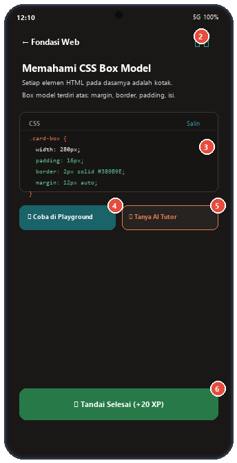
*Gambar 11: Antarmuka Pembaca Modul Pembelajaran Interaktif*

### Cara Belajar Menggunakan Materi Reader:
1. Buka salah satu modul dari Detail Kursus untuk membaca penjelasan terstruktur, tabel ringkasan, catatan penting (*callout*), dan blok kode berwarna (*syntax highlighting*).
2. Ketuk ikon **Bookmark [2]** di bilah atas untuk menyimpan modul favorit ke daftar *Tersimpan*.
3. Pada setiap blok kode **[3]**, ketuk **Salin Kode** untuk menyalin ke clipboard, atau ketuk **Coba di Playground [4]** untuk langsung menjalankan potongan kode tersebut di sandbox eksekusi.
4. Jika ada bagian yang sulit dipahami, ketuk **Tanya AI Tutor [5]** agar konteks modul otomatis dikirim ke AI Tutor Codi.
5. Setelah selesai membaca, ketuk **Tandai Selesai [6]** untuk menyimpan progres ke Room Database, menyalakan streak harian, dan meraih bonus **+20 XP**.

---

## 12. PLAYGROUND INTERAKTIF (WEB STUDIO & JS CONSOLE)

*Gambar 12: Layar Code Playground Multi-Mode (Web Studio & JS Console)*

### Alur Penggunaan Live Code Sandbox:
1. Buka **Playground** dari Drawer, kartu Tips Codi, atau tombol **Coba di Playground** di dalam Materi Reader.
2. Gunakan **Mode Switcher** di bilah atas untuk memilih:
   - **Web Studio:** Tab berkas **`index.html`**, **`style.css`**, dan **`script.js`** lengkap dengan **line numbers gutter**, *syntax highlighting*, dan *auto-save* per kursus. Ketuk **Jalankan Kode / Preview Web** untuk merender halaman web secara real-time di WebView terisolasi (`sandbox://preview`).
   - **JS Console:** Editor khusus **`script.js` (ES6)** dengan terminal konsol permanen di bagian bawah. Ketuk **Jalankan JS** untuk mengeksekusi JavaScript secara *headless* (tanpa kilatan WebView) dan melihat output `console.log`, `[Warn]`, serta `[Error]` yang dapat disalin (*selectable*).
3. Ketuk **Tanya AI** langsung dari Playground untuk mengirim cuplikan kode aktif ke AI Tutor Codi agar Codi memberikan *hint* perbaikan terarah.

---

## 13. FITUR AI TUTOR CERDAS (CODI — GOOGLE GEMINI AI)

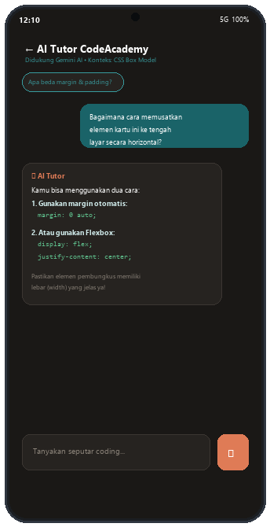
*Gambar 13: Layar Percakapan AI Tutor Codi Berbasis Google Gemini AI*

### Kemampuan & Cara Menggunakan AI Tutor Codi:
1. **Identitas Konsisten & Status Koneksi:** Header menampilkan maskot resmi **Codi**, status koneksi (*Gemini Live / Offline Mode*), dan konteks kursus/modul aktif.
2. **Dukungan 4 Bahasa (Live & Offline):** AI Tutor merespons secara natural sesuai bahasa aktif aplikasi (`id`, `en`, `ja`, `zh`) baik saat terhubung ke model **Gemini 2.5 Flash** maupun saat *offline fallback* (ID/EN).
3. **Saran Pertanyaan Cepat (*Prompt Pills*) & Auto-Scroll Keyboard:** Ketuk pill saran di atas kolom ketik untuk langsung bertanya. Saat keyboard terbuka, area chat otomatis menyesuaikan (`imePadding`) dan menggulir ke pesan terbaru.
4. **Hapus Riwayat Aman & Disclaimer:** Ketuk ikon tempat sampah di pojok kanan atas untuk membersihkan chat (dilengkapi dialog konfirmasi) serta catatan pengingat untuk selalu memverifikasi kode.

---

## 14. SISTEM EVALUASI, KUIS BAB & EVALUASI AKHIR

| Pengerjaan Kuis (Section Quiz) | Hasil Evaluasi (Result Screen) |
| :---: | :---: |
| 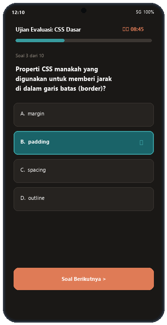 |  |
| *Gambar 14A: Layar Pengerjaan Kuis Berwaktu* | *Gambar 14B: Layar Hasil Evaluasi & Pembahasan* |

### Aturan & Alur Pengerjaan Evaluasi:
1. **Kuis Bab & Evaluasi Akhir:** Setiap kursus dilengkapi kuis per bab (total 9 Kuis Bab dengan deteksi fokus `ON_STOP`) dan 1 Evaluasi Akhir berwaktu sebelum pengumpulan Proyek Akhir.
2. **Ambang Kelulusan (*Passing Grade*):** Siswa dinyatakan **LULUS** jika meraih nilai minimal **70%**. Kelulusan memberikan reward XP dan membuka tahapan kurikulum selanjutnya.
3. **Ulang Kuis & Pembahasan:** Jika nilai belum mencapai 70%, siswa dapat meninjau umpan balik soal lalu menekan **Ulangi Kuis** (*Retake*). Skor kuis akhir otomatis menjadi komponen **40%** dalam perhitungan nilai sertifikat kelulusan.

---

## 15. PENGUMPULAN TUGAS AKHIR (FINAL PROJECT SUBMISSION)

*Gambar 15: Layar Pengumpulan Proyek Akhir (Final Project)*

### Langkah Mengumpulkan Proyek Akhir:
1. Pastikan seluruh modul dan Evaluasi Akhir pada kursus bersangkutan telah selesai dengan skor minimal **70%**.
2. Buka halaman **Proyek Akhir** kursus, baca instruksi studi kasus nyata dan daftar kriteria rubrik penilaian.
3. Lengkapi **URL Repositori / Tautan Proyek**, **Catatan untuk Fasilitator**, serta kode sumber HTML/CSS/JS (dapat diimpor langsung dengan satu ketukan dari **Playground Draft**).
4. Ketuk **Kirim Proyek** untuk mengunggah pengajuan ke koleksi `project_submissions` di Cloud Firestore dengan status awal **`PENDING_REVIEW`**.
5. Pantau hasil review Fasilitator secara real-time di aplikasi:
   - **`REVISION_REQUESTED`**: baca catatan perbaikan dari Fasilitator, perbaiki kode, lalu kirim ulang (*resubmit*).
   - **`APPROVED`**: sertifikat digital ber-ID **`CC-...`** otomatis aktif di layar Sertifikat.

---

## 16. FORUM DISKUSI REAL-TIME, TARGETED REPLY & BADGE STAF

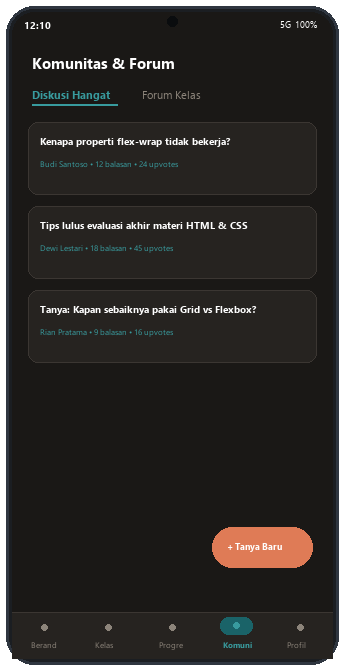
*Gambar 16: Antarmuka Forum Diskusi Kursus & Thread Komentar*

### Fitur & Alur Diskusi di Aplikasi Android:
1. **Sinkronisasi Dua Arah Real-Time:** Thread dan komentar langsung tersinkronisasi antara aplikasi Android dan **Portal Web Fasilitator** melalui koleksi `forum_posts` Firestore.
2. **Filter Diskusi & Badge Peran Bertingkat:** Saring thread menggunakan chip (**Semua**, **Terjawab Fasilitator**, **Milik Saya**, **Populer**). Postingan staf menampilkan badge khusus yang jelas dibedakan:
   - **`SUPER ADMIN`**: Badge berkilau *shimmer* kosmik-emas.
   - **`FASILITATOR`**: Badge Emerald-Gold terverifikasi.
3. **Buka Thread & Balas Spesifik (*Targeted Reply*):**
   - Ketuk pill jumlah balasan untuk memperluas daftar komentar lengkap dengan **Quote Box** kutipan target balasan dan waktu relatif terlokalisasi.
   - Ketuk **Balas** pada topik utama maupun komentar tertentu untuk memunculkan banner *"Membalas @Nama"* (batas 4000 karakter + proteksi timeout jaringan).
4. **Error State 3 Varian Jelas:** Membedakan kondisi **Koneksi Terputus (Offline)**, **Sesi/Izin Bermasalah**, dan **Kendala Server (Coba Lagi)**.

---

## 17. PROGRES BELAJAR, PAPAN PERINGKAT & SERTIFIKAT DIGITAL

*Gambar 17: Papan Peringkat Top 50 & Layar Sertifikat Digital Resmi*

### Rincian Progres, Leaderboard & Sertifikat:
1. **Layar Progres Terstruktur:** Menampilkan **Level & Sisa XP Menuju Level Berikutnya**, kartu **Streak** dan **Sertifikat**, persentase penyelesaian per jalur belajar, serta daftar kursus selesai dengan filter dan *load more*.
2. **Papan Peringkat Pelajar (*Leaderboard* Top 50):**
   - Filter periode (**Mingguan**, **Bulanan**, **Sepanjang Waktu**, **Streak 🔥**) dan filter **Jalur**.
   - **Podium Top 3 Simetris** & **Bar Peringkat Pribadi ("Kamu")** beserta selisih poin ke peringkat di atasnya.
   - Ketuk baris pengguna mana pun (termasuk di Forum) untuk membuka **Dialog Profil Publik** dengan tampilan unik sesuai peran (*Peserta*, *Fasilitator*, atau *Super Admin*).
3. **Sertifikat Digital (`CC-...`) & Berbagi Tautan Verifikasi:** Menampilkan nilai akhir gabungan (**40% Kuis + 60% Proyek**), predikat kelulusan, nomor kredensial unik, tombol **Salin ID**, dan tombol **Bagikan** berisi tautan langsung ke Portal Verifikasi Web (`verify.html?id=CC-...`).

---

## 18. PROFIL PENGGUNA, PROFILE STUDIO, BAHASA & ZONA BERBAHAYA

*Gambar 18: Layar Profil Pengguna, Profile Studio, Peta Aktivitas & Pengaturan*

### Fitur Lengkap Halaman Profil:
1. **Profile Studio & Edit Profil:** Pengguna dapat menyesuaikan **Tema Banner Profil** (6 preset), **Gaya Ikon Avatar** (Inisial, Terminal, Code, Spark, Roket, Desain, Logic, Codi), **Bingkai Avatar**, **Julukan Developer**, hingga **3 Fokus Keahlian (*Skill Tags*)**, dan **Pin Lencana Unggulan**. Validasi nama otomatis aktif bersama penghitung bio 100 karakter.
2. **Tampilan Profil Publik Staf Beranimasi:** Saat membuka profil staf melalui Forum atau Leaderboard, akun **Fasilitator** tampil dengan tema **Emerald-Gold Prestige** berdenyut halus, sedangkan akun **Super Admin** tampil dengan animasi *looping* **Cosmic Aurora Banner + Diagonal Light Sweep + Rotating 360° Halo Ring + Pulsing Aura**.
3. **Peta Aktivitas Belajar (*Heatmap* 12 Minggu):** Matriks kontribusi harian (mode 7 hari vs 12 minggu) lengkap dengan detail aktivitas harian saat kotak diketuk.
4. **Koleksi Lencana (*Badges*) & Preferensi 4 Bahasa:** Menampilkan 12 lencana pencapaian, pengaturan **Mode Gelap / Terang**, notifikasi pengingat, replay Onboarding, dan perpindahan instan **4 Bahasa** (*Bahasa Indonesia*, *English*, *日本語*, *中文*).
5. **Keluar Akun & Zona Berbahaya (Hapus Akun 2 Langkah):** Memerlukan konfirmasi mengetik **`HAPUS`** atau **`DELETE`** untuk membersihkan data lokal Room, DataStore, serta dokumen `users/{uid}` di Firestore secara permanen.

---

## 19. HALAMAN PUBLIK WEB & PORTAL WEB FASILITATOR

Halaman utama web (`https://ivhan9867.github.io/codeacademy-web/`) berperan sebagai **Portal Publik** yang memuat ringkasan platform, tautan baca/unduh Manual Book, pintasan **Verifikasi Sertifikat (`verify.html`)**, serta pintu masuk terpisah ke **Portal Staf (`facilitator/index.html`)**.

*Gambar 19: Dashboard Portal Web Fasilitator CodeAcademy*

### Alur Kerja & Fitur Fasilitator (`accessRole: "facilitator"`):
1. **Autentikasi Live Firebase (`● Live Firebase`):** Masuk dengan **Email/Password** atau **Masuk dengan Google** via Firebase Auth; sistem memverifikasi dokumen `/facilitators/{email}` di Firestore dan otomatis menyinkronkan profil publik staf ke `/users/{uid}` beserta `accessRole` agar tampil unik di aplikasi Android.
2. **Modal Profil Fasilitator:** Klik pill identitas di navbar untuk memperbarui nama, spesialisasi/jabatan, dan bio (tersinkron ke `/facilitators/{email}` dan `/users/{uid}`).
3. **Proyek Akhir (Rubrik 40/60 & Live Preview Aman) [1][2][3]:** Pantau antrean (**Total**, **Menunggu Review**, **Perlu Revisi**, **Disetujui**) **[1]**, saring status/kursus **[2]**, lalu klik **Tinjau** **[3]**. Telaah kode peserta di tab **Live Preview** bersandbox (`sandbox="allow-scripts"`), isi rubrik/skor (`0–100`), lalu pilih **Minta Revisi** atau **Setujui & Terbitkan** (otomatis menulis sertifikat `CC-...` ke Firestore).
4. **Forum Diskusi & Pengumuman:** Filter thread belum terjawab, buat topik/balasan (*Targeted Reply* lengkap dengan `authorAccessRole`), **Pin Jawaban Terverifikasi (`📌`)**, **Tandai Membantu (`💡`)**, serta terbitkan **Pengumuman Kelas** real-time ke aplikasi Android.

---

## 20. PANEL SUPER ADMIN: PROMOSI TIM, BAN SISWA & EXPORT CSV

Akun staf dengan `accessRole: "super_admin"` pada `/facilitators/{email}` otomatis memperoleh lencana **`👑 Super Admin`** di navbar serta akses ke grup menu **Panel Super Admin** di Sidebar Workspace.

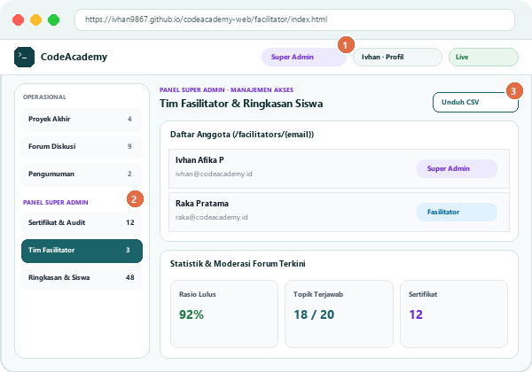
*Gambar 20: Antarmuka Sidebar Workspace & Panel Super Admin CodeAcademy*

### Modul Khusus Super Admin **[1][2][3]**:
1. **Tim Fasilitator & Promosi Peran (`/facilitators/{email}`):**
   - Menambah akun email Google baru sebagai Fasilitator atau Super Admin.
   - **Promosi Peran (`⬆ Jadikan Super Admin`):** Super Admin dapat menaikkan anggota berstatus `facilitator` menjadi `super_admin` dengan dialog konfirmasi.
   - **Perlindungan Sesama Super Admin:** Akun yang sudah berstatus `super_admin` berlabel *Dilindungi* dan tidak dapat diturunkan (*demote*) maupun dicabut aksesnya oleh sesama Super Admin.
2. **Ringkasan Analitik, Klasemen & Kontrol Ban/Unban Siswa (`/users`):**
   - Memantau **Rasio Lulus Proyek (%)**, **Topik Forum Terverifikasi**, **Total Sertifikat Terbit**, dan **Jumlah Siswa Cloud (termasuk status Ban)**.
   - **Ban / Unban Akun Siswa:** Super Admin dapat membekukan akun siswa yang melanggar aturan beserta alasannya (langsung memicu `AccountBannedScreen` di Android) atau mencabut pembekuan (*Unban*) kapan saja.
3. **Sertifikat, Audit & Unduh Laporan CSV [3]:** Memantau & mencabut sertifikat lintas kursus serta mengekspor `codeacademy-sertifikat.csv` dan `codeacademy-nilai-proyek.csv`.

---

## 21. PORTAL VERIFIKASI SERTIFIKAT PUBLIK & KEAMANAN `firestore.rules`

CodeAcademy menyediakan **Portal Verifikasi Kredensial Publik** di `https://ivhan9867.github.io/codeacademy-web/verify.html` (`public/verify.html`) yang melakukan validasi langsung ke Cloud Firestore (`certificates/{certId}`) tanpa data dummy/demo lokal.

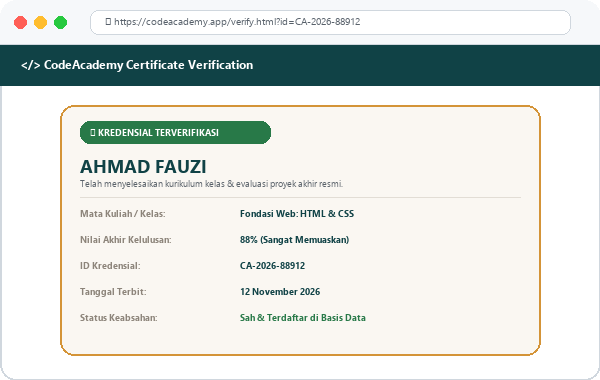
*Gambar 21: Antarmuka Portal Web Verifikasi Sertifikat Digital*

### Cara Validasi & Ringkasan Keamanan `firestore.rules`:
1. **Validasi ID Kredensial (`CC-...`):** Masukkan ID Kredensial pada kolom pencarian atau buka langsung tautan bagikan dari aplikasi (`verify.html?id=CC-...`). Sertifikat valid menampilkan lencana hijau **`✓ KREDENSIAL TERVERIFIKASI`**, nama lulusan, kursus, nilai akhir (**40% Kuis + 60% Proyek**), predikat, tanggal terbit, dan penilai.
2. **Aturan Keamanan `firestore.rules`:**
   - `/facilitators/{email}`: Hanya **`isSuperAdmin()`** yang dapat membaca daftar penuh, menambah, mempromosikan, atau menghapus anggota tim; fasilitator biasa hanya dapat membaca/memperbarui profilnya sendiri tanpa mengubah `accessRole`.
   - `/users/{userId}`: Dapat dibaca oleh pengguna login (untuk Leaderboard & Profil Publik); hanya pemilik dokumen atau `isSuperAdmin()` yang dapat menulis, dan field `isBanned`, `banReason`, `bannedAt`, `bannedBy` hanya boleh diubah oleh `isSuperAdmin()`.
   - `/project_submissions/{id}`: Siswa hanya dapat mengajukan status `PENDING_REVIEW`; skor & keputusan review hanya boleh ditulis oleh `isFacilitator()`.
   - `/forum_posts/{postId}`: Siswa tidak dapat memalsukan flag `isMentor`/`authorIsMentor`; fasilitator berhak memoderasi, menghapus, dan mem-pin jawaban terverifikasi.
   - `/certificates/{certId}` & `/announcements/{id}`: Terbuka dibaca publik/aplikasi, sementara penulisan/pencabutan dijaga ketat oleh aturan validasi skor (`70–100`) dan peran `isFacilitator()`.

---

### Informasi Dokumen:
- **Platform:** CodeAcademy Mobile (Android) & Web Portal (Publik, Fasilitator, Super Admin, Verifikasi)
- **Basis Konten:** Kode Sumber Terkini (`AppDatabase v16`, 4 Bahasa, `156 Modul` / `3 Kursus Front-End`)
- **Template Dokumen:** Pengembangan Bahan Ajar Edisi I 2026
- **Tahun Pembuatan:** 2026
