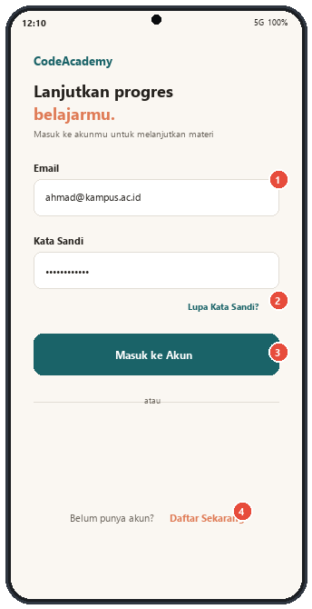
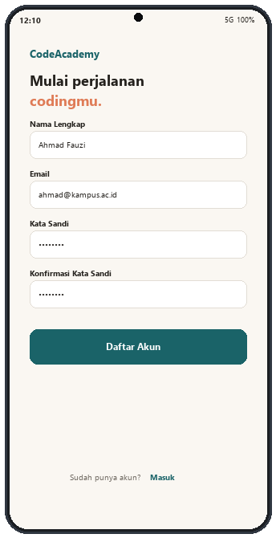
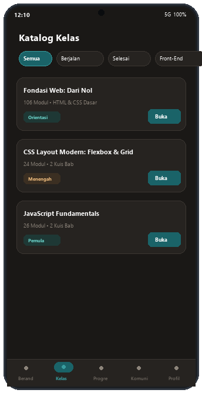
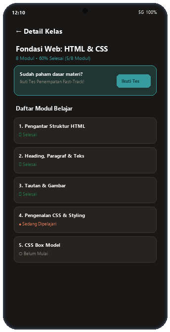
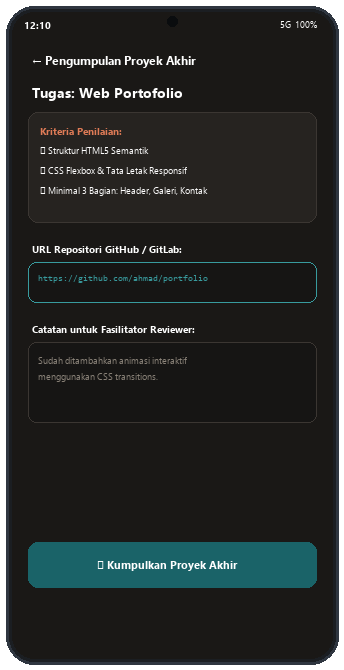
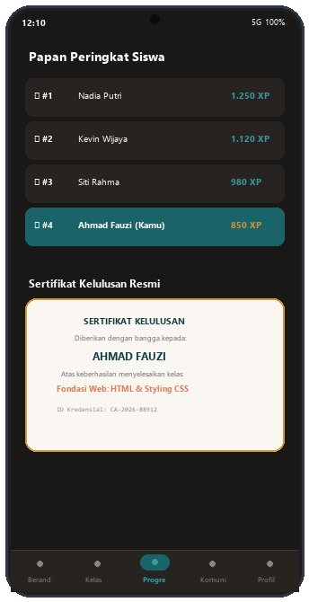
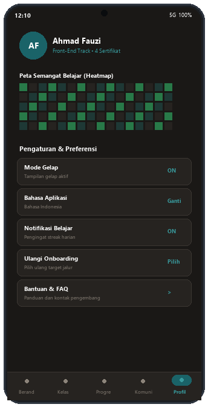

# MANUAL BOOK APLIKASI CODEACADEMY (VERSI MOBILE)
## Platform Pembelajaran Web Development & Coding Mobile-First
### Dokumen Buku Panduan Pengguna — Lampiran Tugas Akhir

---

## DAFTAR ISI

- **Halaman Awal** .......................................................................................... i
- **Daftar Isi** .................................................................................................. ii
- **1. Pengenalan Aplikasi CodeAcademy** .................................................... 1
- **2. Download dan Instalasi Aplikasi Versi Mobile** .................................... 2
- **3. Pendaftaran Akun, Masuk & Pemulihan Sandi** .................................... 3
- **4. Alur Onboarding Siswa Baru** .............................................................. 4
- **5. Pengenalan Fitur Beranda (Home Dashboard)** ..................................... 5
- **6. Navigasi Menu Samping (Drawer) & Pencarian Materi** ....................... 6
- **7. Katalog Kelas & Detail Silabus Kursus** ................................................ 7
- **8. Fitur Pembelajaran Interaktif (Materi Reader)** .................................... 8
- **9. Fitur Playground Interaktif (Live Code Sandbox)** ............................... 9
- **10. Fitur AI Tutor Cerdas (Didukung Gemini AI)** .................................. 10
- **11. Sistem Evaluasi, Kuis Bab & Hasil Evaluasi** ....................................... 11
- **12. Pengumpulan Tugas Akhir (Final Project Submission)** ....................... 12
- **13. Forum Diskusi & Komunitas Belajar** ................................................... 13
- **14. Progres Belajar, Gamifikasi & Sertifikat Digital** ................................ 14
- **15. Profil Pengguna & Pengaturan Aplikasi** ............................................. 15
- **16. Portal Web Fasilitator & Penilaian Tugas Akhir** ................................ 16
- **17. Portal Web Verifikasi Sertifikat & Validasi Kredensial** ................... 17

---

## 1. PENGENALAN APLIKASI CODEACADEMY

Aplikasi **CodeAcademy** merupakan platform pembelajaran pemrograman dan web development berbasis *mobile-first* yang dirancang untuk memberikan pengalaman belajar coding terstruktur, fleksibel, dan interaktif langsung dari smartphone. Aplikasi ini ditujukan untuk memfasilitasi mahasiswa dan pembelajar pemula dalam menguasai keterampilan rekayasa perangkat lunak tanpa ketergantungan penuh pada laptop/komputer meja.

### Fitur-Fitur Utama:
1. **Kurikulum Komprehensif Berjenjang:** Fokus pada jalur spesialisasi **Front-End Web Development** yang mencakup 3 kelas utama: *Fondasi Web (HTML & CSS Dasar — 106 Modul)*, *CSS Layout Modern (Flexbox & Grid — 24 Modul)*, dan *JavaScript Fundamentals (ES6 & DOM — 26 Modul)*.
2. **AI Tutor Cerdas (Didukung Google Gemini AI):** Asisten personal interaktif yang siap membantu menjelaskan konsep, menelusuri logika kode, dan melakukan *debugging* kesalahan sintaks secara real-time.
3. **Interactive Code Playground:** Lingkungan eksperimen kode (*live sandbox*) multi-tab (HTML, CSS, JS) dengan *live preview* render tampilan visual langsung di layar ponsel.
4. **Sistem Kuis & Evaluasi Berwaktu:** Ujian evaluasi di setiap akhir bab materi dengan *passing grade* kelulusan (minimal 70%).
5. **Gamifikasi Edukatif:** Poin XP, tingkat level siswa (*Code Newbie* hingga *Code Master*), runtutan belajar harian (*Daily Streak*), koleksi lencana (*Badges*), dan matriks keaktifan (*Heatmap*).
6. **Forum Komunitas Kelas & Diskusi Hangat:** Media sosial edukatif untuk berdiskusi, bertanya masalah kode, dan saling memberikan solusi.
7. **Pengumpulan Proyek Akhir (Final Project):** Tugas studi kasus nyata dengan rubrik penilaian standar industri rekayasa perangkat lunak.
8. **Sertifikat Digital Resmi:** Dilengkapi nomor ID verifikasi kredensial kelulusan unik yang dapat diverifikasi keasliannya.

*Gambar 1: Tampilan Layar Pembuka (Splash Screen) Aplikasi CodeAcademy Mobile*

---

## 2. DOWNLOAD DAN INSTALASI APLIKASI VERSI MOBILE

### Spesifikasi Kebutuhan Sistem Minimum:
- **Sistem Operasi:** Android 8.0 (Oreo) atau versi yang lebih tinggi (API Level 26+).
- **Memori RAM:** Minimal 2 GB (disarankan 4 GB untuk performa rendering *playground* optimal).
- **Ruang Penyimpanan Kosong:** Minimal 150 MB.
- **Koneksi Jaringan:** Memerlukan akses internet aktif untuk sinkronisasi data dan layanan AI Tutor.

### Langkah-Langkah Pemasangan (Instalasi APK):
1. Unduh berkas installer `CodeAcademy-v1.0-release.apk` dari repositori resmi proyek tugas akhir.
2. Buka folder **Unduhan** (*Downloads*) menggunakan aplikasi Pengelola Berkas (*File Manager*) di smartphone Anda.
3. Ketuk berkas installer APK tersebut.
4. Jika perangkat Anda menampilkan peringatan keamanan sumber tidak dikenal (*Unknown Sources*), pilih opsi **Setelan** lalu aktifkan tombol izin **Izinkan penginstalan aplikasi dari sumber ini** (*Allow from this source*).
5. Pada kotak dialog penginstal paket Android yang muncul, ketuk tombol **INSTAL** (lihat penunjuk nomor 1 pada Gambar 2).
6. Tunggu beberapa detik hingga sistem menyelesaikan proses verifikasi dan pemasangan.
7. Setelah selesai, ketuk tombol **Buka** untuk mulai menjalankan aplikasi CodeAcademy.

*Gambar 2: Kotak Dialog Penginstal Paket Android*

#### Keterangan Gambar:
- **[1] Tombol Instal:** Ketuk tombol ini untuk mengonfirmasi pemasangan berkas aplikasi CodeAcademy ke smartphone Anda.

---

## 3. PENDAFTARAN AKUN, MASUK & PEMULIHAN SANDI

Sebelum dapat menyimpan progres belajar dan mengklaim sertifikat kelulusan, siswa diwajibkan memiliki akun terdaftar di aplikasi.

| Layar Masuk (Login) | Layar Pendaftaran (Register) |
| :---: | :---: |
|  |  |
| *Gambar 3A: Formulir Masuk* | *Gambar 3B: Formulir Pendaftaran* |

### Langkah Masuk Akun (Login):
1. Buka aplikasi CodeAcademy. Pada layar masuk, ketik alamat email Anda pada kolom **Email** [1].
2. Masukkan kata sandi akun pada kolom **Kata Sandi** [1].
3. Ketuk tombol **Masuk ke Akun** [3] untuk mengakses dashboard utama.
4. **Alternatif Cepat (Masuk dengan Google):** Ketuk tombol **Masuk dengan Google** di bawah tombol masuk untuk login instan menggunakan akun Google yang terpasang di perangkat.
5. Jika lupa kata sandi, ketuk tautan **Lupa Kata Sandi?** [2] untuk masuk ke alur pemulihan akun.

### Langkah Pendaftaran Akun Baru (Register):
1. Pada bagian bawah form login, ketuk tautan **Daftar Sekarang** [4].
2. Isi formulir pendaftaran dengan lengkap:
   - **Nama Lengkap:** Masukkan nama lengkap siswa (minimal 2 karakter).
   - **Email:** Masukkan alamat email aktif (contoh: `nama@kampus.ac.id`).
   - **Kata Sandi:** Masukkan kata sandi baru (minimal 6 karakter).
   - **Konfirmasi Kata Sandi:** Masukkan ulang kata sandi untuk verifikasi kecocokan.
3. Ketuk tombol **Daftar Akun** untuk membuat akun baru secara manual.
4. **Alternatif Cepat (Daftar dengan Google):** Ketuk tombol **Daftar dengan Google** di bawah tombol daftar. Sistem akan memverifikasi akun Google Anda dan secara otomatis membuat profil siswa baru lalu membawa Anda ke alur *Onboarding*.

#### Keterangan Gambar:
- **[1] Kolom Input Email & Sandi:** Memasukkan kredensial autentikasi pengguna.
- **[2] Lupa Kata Sandi?:** Mengarahkan ke layar pemulihan sandi baru jika pengguna lupa password.
- **[3] Tombol Masuk ke Akun:** Mengirim data login untuk diverifikasi oleh sistem.
- **[4] Tautan Daftar Sekarang:** Mengalihkan pengguna baru ke formulir pembuatan akun.

---

## 4. ALUR ONBOARDING SISWA BARU

Setelah registrasi berhasil, siswa akan disambut oleh alur interaktif *Onboarding* (5 langkah) untuk menyesuaikan preferensi dan tujuan belajar:

*Gambar 4: Layar Pemilihan Jalur Belajar pada Onboarding*

1. **Langkah 1 (Welcome Step):** Sambutan selamat datang bersama maskot Codi serta pengenalan metode belajar *microlearning* Web Development.
2. **Langkah 2 (Code Preview Step):** Demonstrasi pratinjau penulisan kode HTML dan hasil tampilannya secara langsung.
3. **Langkah 3 (Community Step):** Pengenalan ekosistem forum diskusi antar sesama pelajar dan papan peringkat mingguan.
4. **Langkah 4 (Track Selection Step):** Konfirmasi jalur belajar aktif **Front-End Web Development** (HTML5, CSS3, Flexbox/Grid, dan JavaScript).
5. **Langkah 5 (Plan Summary Step):** Ringkasan rencana belajar, pemilihan tujuan belajar, dan penetapan target komitmen waktu harian.

---

## 5. PENGENALAN FITUR BERANDA (HOME DASHBOARD)

Beranda adalah pusat aktivitas utama tempat siswa memantau progres, melanjutkan materi yang tertunda, dan menyelesaikan misi harian.

*Gambar 5: Halaman Beranda (Home Dashboard)*

#### Keterangan Gambar:
- **[1] Menu Samping (Drawer):** Membuka menu navigasi cepat menuju fitur Cari Materi, Tersimpan, dan Playground.
- **[2] Badge Runtutan (Streak Harian):** Menghitung jumlah hari belajar berturut-turut untuk menjaga kedisiplinan koding.
- **[3] Carousel Banner Promosi:** Kartu interaktif yang menampilkan modul rekomendasi dan capaian target XP mingguan.
- **[4] Kartu Lanjutkan Belajar:** Pintasan instan menuju modul terakhir yang sedang dikerjakan agar siswa tidak kehilangan alur belajar.
- **[5] Bilah Navigasi Bawah (Bottom Navigation Bar):** Menu akses cepat ke 5 fitur inti: *Beranda*, *Kelas*, *Progres*, *Komunitas*, dan *Profil*.

---

## 6. NAVIGASI MENU SAMPING & PENCARIAN MATERI

Aplikasi CodeAcademy dilengkapi laci navigasi samping (*Navigation Drawer*) dan fitur *Search* global untuk mempercepat pencarian materi lintas kelas.

| Menu Navigasi Samping (Drawer) | Pencarian Materi Global (Search) |
| :---: | :---: |
|  |  |
| *Gambar 6A: Laci Navigasi Samping* | *Gambar 6B: Layar Pencarian Materi* |

#### Keterangan Fitur:
- **Profil Singkat Siswa:** Menampilkan inisial avatar, nama lengkap, gelar level (*Lv. 4 Code Builder*), dan total poin XP.
- **Pintasan Aktivitas:** Akses cepat ke *Modul Tersimpan* (Bookmarks), *Notifikasi*, dan *Sertifikat Saya*.
- **Tools Koding:** Akses instan menuju *Playground Live* dan *Tanya AI Tutor*.
- **Pencarian Lintas Kelas:** Siswa dapat mengetik kata kunci topik teknis (misal: "Flexbox", "Loop", "Pointer"). Sistem menampilkan daftar materi yang relevan beserta modul dan kelas asalnya.

---

## 7. KATALOG KELAS & DETAIL SILABUS KURSUS

Menu **Kelas** menyajikan katalog kurikulum terstruktur yang disusun secara berjenjang berdasarkan tingkat kemahiran siswa.

| Katalog Kelas (Course Catalog) | Detail Kelas (Class Detail) |
| :---: | :---: |
|  |  |
| *Gambar 7A: Katalog Kursus* | *Gambar 7B: Detail Silabus Kelas* |

#### Keterangan Fitur:
- **Filter Status & Jalur Belajar:** Mengelompokkan kelas berdasarkan progres (*Semua*, *Berjalan*, *Selesai*) serta tingkat kesulitan (*Orientasi*, *Pemula*, *Pemula-Menengah*).
- **Pill Tingkat Kesulitan:** Label penunjuk level kemahiran (*Pemula*, *Menengah*, atau *Lanjut*).
- **Fast-Track Placement Test:** Bagi siswa yang telah menguasai konsep dasar, tersedia tes penempatan awal untuk melewati materi pendahuluan secara cepat (*fast-track*) dan meraih bonus XP.
- **Silabus Berstruktur Bab:** Setiap kelas diorganisasikan ke dalam Bab Persiapan, Pendahuluan, Materi Inti, Lanjutan, dan Evaluasi Akhir.

---

## 8. FITUR PEMBELAJARAN INTERAKTIF (MATERI READER)

Layar baca modul pembelajaran didesain dengan prinsip *mobile-first* agar materi teks teknis dan baris kode mudah dibaca di layar smartphone.

*Gambar 8: Layar Pembaca Modul Pembelajaran Interaktif*

#### Keterangan Fitur & Alat Bantu:
- **[2] Tombol Bookmark:** Menandai materi ke dalam daftar *Modul Tersimpan* agar dapat dibuka kembali sewaktu-waktu secara instan.
- **[3] Blok Kode Syntax Highlighting:** Kode diformat dengan pewarnaan sintaks standar industri dan tombol **Salin Kode** ke *clipboard*.
- **[4] Tombol 'Coba di Playground':** Membuka potongan kode langsung ke sandbox eksekusi koding untuk dieksplorasi secara bebas.
- **[5] Tombol 'Tanya AI Tutor':** Mengirimkan konteks materi yang sedang dibaca ke AI Tutor untuk penjelasan konsep lebih mendalam.
- **[6] Tombol 'Tandai Selesai':** Menyimpan status penyelesaian modul ke basis data lokal Room dan memberikan reward +20 XP.

---

## 9. FITUR PLAYGROUND INTERAKTIF (LIVE CODE SANDBOX)

Fitur *Playground* merupakan lingkungan koding terintegrasi (*live sandbox*) yang memungkinkan siswa bereksperimen langsung dengan kode tanpa perlu menginstal aplikasi compiler atau text editor di komputer.

*Gambar 9: Layar Playground Interaktif*

#### Keterangan Fitur Playground:
- **Tab Editor Berkas:** Mendukung perpindahan cepat antara editor HTML (`index.html`), CSS (`style.css`), JavaScript (`script.js`), dan tab **Preview Web**.
- **Editor Kode Khusus Pemrograman:** Mendukung pengetikan sintaks tanpa gangguan *auto-correct*, scroll vertikal & horizontal, serta penyimpanan draf otomatis (*auto-save*).
- **Live Preview & Sandbox Aman:** Menampilkan render visual halaman web secara instan beserta panel **Output Console** (`console.log`) yang dapat digulir dan dibersihkan, serta proteksi tautan eksternal agar tetap berada di dalam sandbox.
- **Tombol 'Tanya AI':** Mengirimkan kode yang sedang ditulis ke AI Tutor jika siswa menemui *bug* atau kesalahan sintaks.

---

## 10. FITUR AI TUTOR CERDAS (DIDUKUNG GEMINI AI)

AI Tutor bertindak sebagai asisten pemrograman pribadi siswa yang siap mendampingi proses belajar selama 24 jam penuh. Fitur ini ditenagai oleh **Firebase AI Logic (Google Gemini AI)**.

*Gambar 10: Layar Percakapan Interaktif AI Tutor*

#### Fitur & Kemampuan Unggulan:
- **Konteks Sadar Materi (*Context-Aware*):** AI secara otomatis membaca judul modul atau kelas yang sedang dibuka siswa, sehingga respon yang diberikan sangat spesifik dan relevan.
- **Prompt Pills (Rekomendasi Cepat):** Memberikan ide pertanyaan cerdas untuk memperdalam konsep koding dengan satu ketukan.
- **Debugging & Pemecahan Error:** Siswa dapat menempelkan potongan kode yang bermasalah, dan AI Tutor akan mengidentifikasi letak kesalahan serta memberikan rekomendasi perbaikannya.
- **Format Penjelasan Pedagogis & Coba di Playground:** Penjelasan disusun secara ramah pemula, menggunakan analogi sederhana, serta tombol **"Coba di Playground"** pada blok kode balasan untuk langsung mempraktikkan saran AI.

---

## 11. SISTEM EVALUASI, KUIS BAB & HASIL EVALUASI

Untuk mengukur pemahaman materi siswa di setiap akhir bab atau kelas, aplikasi menyediakan kuis evaluasi berwaktu.

| Pengerjaan Kuis (Section Quiz) | Hasil Evaluasi (Result Screen) |
| :---: | :---: |
|  |  |
| *Gambar 11A: Layar Pengerjaan Kuis* | *Gambar 11B: Layar Hasil Evaluasi* |

#### Prosedur & Aturan Ujian:
1. **Timer Hitung Mundur:** Setiap sesi kuis memiliki batas waktu pengerjaan untuk menguji ketangkasan pemahaman siswa.
2. **Pilihan Ganda Interaktif:** Pilihan jawaban dilengkapi penanda visual yang jelas.
3. **Passing Grade Kelulusan:** Siswa dinyatakan **LULUS** apabila memperoleh skor minimal **70%**.
4. **Perolehan XP & Sertifikat:** Kelulusan kuis memberikan reward poin XP (+50 s.d. +100 XP) serta membuka akses ke modul selanjutnya atau pengumpulan proyek akhir.
5. **Tombol Retake & Pembahasan:** Siswa yang belum lulus dapat mengulang kuis atau meninjau modul pembahasan.

---

## 12. PENGUMPULAN TUGAS AKHIR (FINAL PROJECT SUBMISSION)

Sebagai syarat akhir kelulusan kompetensi pada setiap kelas spesialisasi, siswa wajib menyelesaikan dan mengumpulkan sebuah Proyek Akhir studi kasus nyata.

*Gambar 12: Layar Pengumpulan Tugas Akhir*

#### Prosedur Pengumpulan Proyek:
1. **Spesifikasi & Brief Tugas:** Meninjau panduan dan tujuan pembuatan proyek (misal: "Membuat Web Portofolio Responsif").
2. **Rubrik Penilaian:** Memastikan seluruh kriteria teknis terpenuhi (HTML semantik, layout Flexbox/Grid, responsivitas layar).
3. **Input URL Repositori:** Siswa memasukkan tautan repositori kode sumber (GitHub / GitLab) dan link demo website aktif.
4. **Catatan untuk Fasilitator:** Siswa dapat menyertakan penjelasan tambahan mengenai tantangan teknis atau fitur istimewa yang dibuat.
5. **Fitur Impor dari Playground:** Kode yang telah dibuat di Playground dapat diimpor langsung tanpa perlu menyalin ulang.
6. **Submisi & Penerbitan Sertifikat:** Setelah disetujui, sistem secara otomatis menerbitkan Sertifikat Kelulusan resmi.

---

## 13. FORUM DISKUSI & KOMUNITAS BELAJAR

Menu Komunitas menyediakan wadah sosial edukatif bagi seluruh siswa untuk berkolaborasi, bertanya mengenai kendala koding, dan berbagi wawasan.

*Gambar 13: Layar Forum Diskusi Komunitas*

#### Fitur Komunitas:
- **Tab Diskusi Hangat (*Trending*):** Menampilkan thread pertanyaan paling aktif yang memperoleh apresiasi upvote terbanyak dari sesama siswa.
- **Tab Forum Kelas:** Diskusi terfokus yang dikelompokkan secara spesifik per mata kuliah / materi modul.
- **Tombol 'Tanya Baru':** Formulir pembuatan pertanyaan baru lengkap dengan judul kendala, kategori kelas, dan lampiran potongan kode.
- **Sistem Upvote & Komentar Solutif:** Memberikan apresiasi pada jawaban terbaik dan membangun budaya belajar gotong-royong.

---

## 14. PROGRES BELAJAR, GAMIFIKASI & SERTIFIKAT DIGITAL

Fitur Progres dan Papan Peringkat dirancang untuk menjaga motivasi dan konsistensi belajar siswa secara berkelanjutan.

*Gambar 14: Papan Peringkat Siswa & Sertifikat Kelulusan Resmi*

#### Komponen Gamifikasi & Sertifikasi:
1. **Papan Peringkat Pelajar (*Leaderboard*):** Menampilkan peringkat siswa teratas (Top 50) mingguan dan global berdasarkan akumulasi perolehan XP.
2. **Sistem Medali (🥇🥈🥉):** Apresiasi khusus bagi peringkat 3 besar pembelajar teraktif.
3. **Koleksi Lencana (*Badges*):** Penghargaan digital atas pencapaian tertentu (contoh: *Langkah Pertama*, *Api Abadi*, *AI Enthusiast*, *Full-Stack Hero*).
4. **Sertifikat Kelulusan Resmi:** Dokumen digital resmi yang memuat nama siswa, kelas yang diselesaikan, dan **ID Kredensial Unik** (contoh: `CA-2026-88912`) untuk validasi keabsahan sertifikat secara daring.

---

## 15. PROFIL PENGGUNA & PENGATURAN APLIKASI

Halaman Profil memberikan kontrol penuh kepada siswa untuk mengatur preferensi tampilan antarmuka, mengelola data akun, dan meninjau rekam jejak pribadi.

*Gambar 15: Layar Profil & Pengaturan Aplikasi*

#### Fitur Profil & Personalisasi:
- **Header Profil & Statistik:** Menampilkan avatar, nama lengkap, total sertifikat kelulusan, dan jalur spesialisasi aktif.
- **Peta Semangat Belajar (*Activity Heatmap*):** Visualisasi matriks kontribusi harian ala GitHub yang mencatat frekuensi aktivitas koding siswa.
- **Mode Gelap (*Dark Mode / Light Mode*):** Tombol sakelar pengubah tema kontras gelap atau terang untuk kenyamanan mata saat belajar di kondisi minim cahaya.
- **Pilihan Bahasa Antarmuka:** Mendukung antarmuka multi-bahasa: **Bahasa Indonesia**, **English**, **Jepang**, dan **Mandarin**.
- **Pengingat Belajar (*Notifications*):** Pengaturan notifikasi pengingat harian agar siswa tidak melewatkan *streak* belajar.
- **Ulangi Onboarding & Keluar Akun:** Fitur untuk memilih ulang jalur spesialisasi atau keluar (*logout*) dari sesi akun lokal dengan aman.

---

## 16. PORTAL WEB FASILITATOR & PENILAIAN TUGAS AKHIR

Untuk menjamin kenyamanan telaah kode sumber di layar lebar, integritas akademik, dan pemisahan hak akses antara siswa dan penilai, sistem evaluasi Proyek Akhir dipisahkan ke dalam **Portal Web Fasilitator** yang di-host di `https://ivhan9867.github.io/codeacademy-web/facilitator/index.html` (`public/facilitator/index.html`).

*Gambar 16: Antarmuka Dashboard Web Penilai / Fasilitator CodeAcademy*

### Fitur & Alur Penilaian Fasilitator:
1. **Otentikasi Keamanan Passcode Sesi:** Portal dilindungi dengan gerbang passcode khusus fasilitator (`CA-FAC-2026`) untuk mencegah akses evaluasi oleh pihak luar yang tidak berwenang.
2. **Antrean Pengumpulan Real-Time (*Cloud Firestore Sync*):** Daftar pengumpulan tugas akhir mahasiswa dari project Firebase `codeacademy-6a361` masuk dan tersinkronisasi secara langsung (*real-time listener*) dengan indikator **`● Live Firestore Sync`**.
3. **Pemeriksa Kode (*Code Source*) & Live Preview:** Fasilitator dapat meneliti kode sumber HTML/CSS/JS secara berdampingan dengan tab **Live Preview** terisolasi (`sandbox="allow-scripts"`).
4. **Formulir Rubrik Penilaian & Kalkulator Skor:** 
   - **Skor Proyek (0–100):** Digabung otomatis dengan skor Kuis Aplikasi (`35% Kuis + 65% Proyek`) untuk menentukan Nilai Akhir Sertifikat.
   - **Tag Umpan Balik Cepat & Catatan:** Komentar kualitatif untuk memberikan arahan perbaikan teknis atau apresiasi kode.
5. **Tombol Keputusan (`Setujui & Terbitkan` / `Minta Revisi`):**
   - **Setujui & Terbitkan (*Approved*):** Menerbitkan status lulus dan menyinkronkan **Sertifikat Digital** resmi ke akun siswa serta Cloud Firestore.
   - **Minta Revisi (*Revision*):** Mengembalikan status agar siswa dapat memperbaiki proyeknya di aplikasi Android disertai catatan perbaikan dari fasilitator.
6. **Sinkronisasi Otomatis ke Smartphone Siswa:** Siswa yang sedang membuka layar *Final Project Submission* di aplikasi Android akan langsung melihat perubahan status dan catatan review secara instan tanpa perlu keluar aplikasi.

---

## 17. PORTAL WEB VERIFIKASI SERTIFIKAT & VALIDASI KREDENSIAL

CodeAcademy menyediakan **Portal Verifikasi Kredensial Publik** di `https://ivhan9867.github.io/codeacademy-web/verify.html` (`public/verify.html`) yang dapat diakses secara bebas melalui peramban web untuk menjamin keaslian dan validitas sertifikat digital yang diperoleh oleh siswa.

*Gambar 17: Antarmuka Portal Verifikasi Sertifikat Digital Online*

### Fitur & Cara Validasi Sertifikat:
1. **Pencarian Kode Kredensial Instan:** Memungkinkan siapa saja (dosen pembimbing, pihak kampus, recruiter perusahaan) memasukkan ID Kredensial unik (contoh: `CA-2026-88912`) untuk mencari rekaman asli di basis data Firestore.
2. **Lencana Keabsahan (*Verified Authentic*):** Sertifikat yang sah akan menampilkan lencana hijau centang resmi yang menyatakan dokumen terdaftar dan valid.
3. **Transparansi Detail Kelulusan:**
   - **Nama Lengkap Siswa**
   - **Jalur Spesialisasi Kursus** (misal: *Front-End Web Development*)
   - **Tanggal Kelulusan & Penerbitan Sertifikat**
   - **Skor Proyek Akhir & Predikat** (contoh: *Skor 92/100 - Sangat Memuaskan*)
4. **Integrasi Tautan Langsung dari Aplikasi Mobile:**
   - Tombol **Bagikan** (*Share Intent*) di layar Sertifikat aplikasi Android melampirkan detail dan ID kredensial untuk diverifikasi di portal resmi, misalnya:  
     `https://ivhan9867.github.io/codeacademy-web/verify.html?certId=CA-2026-88912`
   - Penerima tautan cukup membuka link tersebut untuk langsung melihat lembar verifikasi resmi tanpa perlu mengetik ulang ID.
5. **Proteksi Anti-Pemalsuan Dokumen:** Setiap sertifikat terhubung unik ke kombinasi `UID Siswa` dan `ID Kursus`, memastikan sertifikat tidak dapat dipalsukan atau digunakan oleh pihak lain.

---

### Informasi Dokumen:
- **Aplikasi:** CodeAcademy Mobile (Android)
- **Tujuan Dokumen:** Manual Book / Buku Panduan Pengguna Tugas Akhir
- **Tahun Pembuatan:** 2026
