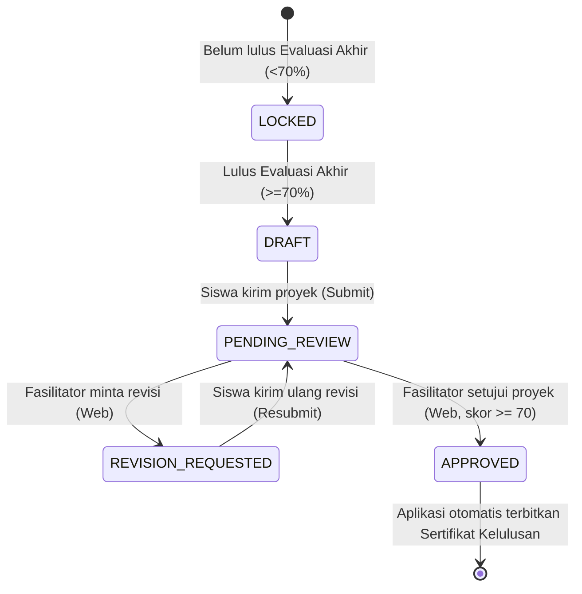

# Kontrak Integrasi Web Dashboard Fasilitator (Firebase Firestore)

Dokumen ini mendefinisikan skema koleksi cloud **Firebase Firestore** yang digunakan oleh aplikasi mobile **CodeAcademy (Android Kotlin)** untuk fitur **Submission Proyek Akhir Kelas** dan yang akan dikonsumsi oleh **Web Dashboard Fasilitator** saat dibangun secara terpisah.

---

## 1. Nama Koleksi & Format Document ID

- **Collection Name**: `project_submissions`
- **Document ID Format**: `{studentUid}_{courseId}`
  - Contoh: `u_abc123xyz_fe-web-foundation-00`
  - Dengan format komposit ini, setiap siswa memiliki tepat satu dokumen aktif per kelas yang mendukung *resubmission* (pengiriman ulang revisi) dengan riwayat `attemptCount`.

---

## 2. Struktur Field Dokumen (`project_submissions/{id}`)

| Field | Tipe Firestore | Diisi Oleh | Deskripsi |
| :--- | :--- | :--- | :--- |
| `id` | `string` | Mobile App | ID dokumen (`{studentUid}_{courseId}`) |
| `courseId` | `string` | Mobile App | ID kelas (`fe-web-foundation-00`, `fe-css-02`, `fe-js-03`, `be-node-01`, `py-fund-01`, `c-fund-01`, `cpp-fund-01`) |
| `courseTitle` | `string` | Mobile App | Nama kelas saat dikirim |
| `studentUid` | `string` | Mobile App | UID Firebase Auth siswa (atau `local_student` jika mode lokal) |
| `studentName` | `string` | Mobile App | Nama lengkap siswa untuk ditampilkan di antrean Web Fasilitator |
| `studentEmail` | `string` | Mobile App | Email siswa |
| `submissionCode` | `string` | Mobile App | Kode proyek akhir dari Workspace Editor siswa |
| `projectUrl` | `string` | Mobile App | Tautan repositori GitHub / Gist / Demo eksternal (opsional) |
| `studentNotes` | `string` | Mobile App | Catatan penjelasan siswa untuk fasilitator |
| `checkedRubricIds` | `string` | Mobile App | Daftar ID item rubrik yang telah dicentang siswa (dipisahkan koma, mis. `"r1,r2,r3,r4"`) |
| `status` | `string` | Mobile & Web | Status siklus hidup submission: `"DRAFT"`, `"PENDING_REVIEW"`, `"REVISION_REQUESTED"`, atau `"APPROVED"` |
| `finalQuizScore` | `number` (int) | Mobile App | Skor terbaik Evaluasi Akhir Kelas siswa (`0`–`100`, bobot 40% nilai akhir sertifikat) |
| `facilitatorScore` | `number` (int?) | Web Fasilitator | Skor penilaian proyek akhir dari fasilitator (`0`–`100`, bobot 60% nilai akhir sertifikat) |
| `facilitatorFeedback` | `string` | Web Fasilitator | Catatan umpan balik / instruksi revisi dari fasilitator (mendukung Markdown) |
| `reviewedBy` | `string` | Web Fasilitator | Nama / identitas fasilitator penilai |
| `submittedAt` | `number` (long) | Mobile App | Epoch milliseconds saat siswa menekan **Kirim ke Fasilitator** |
| `reviewedAt` | `number` (long?) | Web Fasilitator | Epoch milliseconds saat fasilitator menyimpan hasil review |
| `attemptCount` | `number` (int) | Mobile App | Jumlah pengiriman proyek oleh siswa (`1`, `2`, dst.) |

---

## 3. Siklus Hidup Status (`ProjectSubmissionStatus`)



---

## 4. Query untuk Web Dashboard Fasilitator

### A. Mengambil Antrean Submission yang Menunggu Penilaian
```javascript
import { collection, query, where, orderBy, onSnapshot } from "firebase/firestore";

const q = query(
  collection(db, "project_submissions"),
  where("status", "==", "PENDING_REVIEW"),
  orderBy("submittedAt", "asc")
);
```

### B. Menyimpan Hasil Penilaian Fasilitator (Approve / Minta Revisi)
Ketika fasilitator menilai submission di Web Dashboard, lakukan `updateDoc` atau `setDoc(..., { merge: true })`:

```javascript
import { doc, updateDoc } from "firebase/firestore";

// Contoh: Menyetujui Proyek Akhir (Lulus)
await updateDoc(doc(db, "project_submissions", submissionId), {
  status: "APPROVED", // atau "REVISION_REQUESTED" jika perlu revisi
  facilitatorScore: 92,
  facilitatorFeedback: "Struktur kode sangat rapi dan seluruh spesifikasi proyek terpenuhi.",
  reviewedBy: "Rizky Pratama, M.Kom (Fasilitator)",
  reviewedAt: Date.now()
});
```

---

## 5. Perilaku Real-Time di Aplikasi Mobile

1. Aplikasi mobile memasang snapshot listener (`attachProjectSubmissionListener`) pada dokumen `project_submissions/{studentUid}_{courseId}`.
2. Saat Web Fasilitator mengubah `status` menjadi `"APPROVED"`:
   - Aplikasi mobile secara otomatis memperbarui database Room lokal (`ProjectSubmissionEntity`).
   - Menghitung nilai akhir sertifikat dengan rumus:
     $$\text{Final Certificate Score} = \text{round}(0.40 \times \text{finalQuizScore} + 0.60 \times \text{facilitatorScore})$$
   - Menerbitkan `CertificateEntity` resmi ke Room & Firestore, memberikan **+150 XP**, membuka lencana kelulusan, dan menampilkan notifikasi kelulusan kepada siswa.
3. Saat Web Fasilitator mengubah `status` menjadi `"REVISION_REQUESTED"`:
   - Aplikasi mobile menampilkan kartu **Hasil Evaluasi & Catatan Fasilitator**, membuka kembali editor Workspace siswa untuk perbaikan, dan mengirimkan notifikasi revisi.
